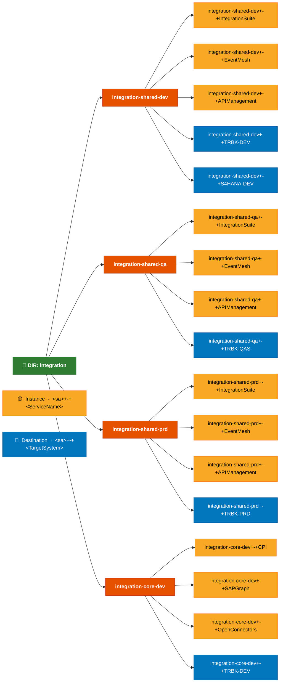
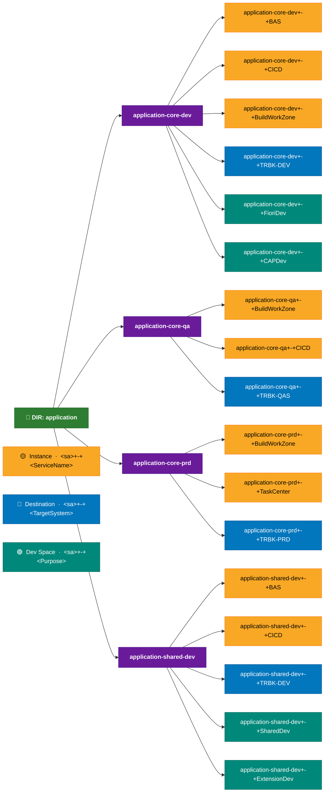
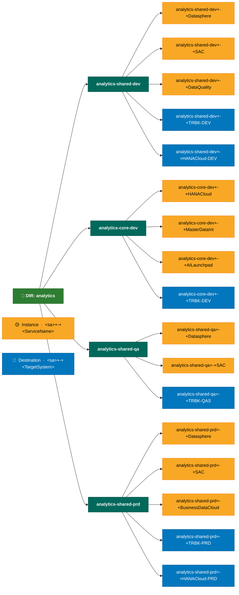
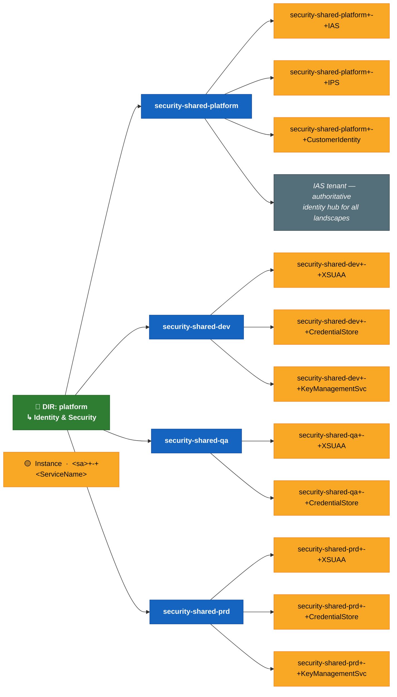

# ASB Bank NZ — SAP BTP Account Hierarchy Diagrams

> All diagrams use standard ADO Wiki Mermaid syntax (`flowchart LR` / `flowchart TD`).
> Copy each fenced block directly into an ADO Wiki page.
> Naming conventions follow the standard: `<sub-account-name>+-+<Qualifier>`

---

## Diagram 1 — Full Account Hierarchy Overview

> **Purpose**: Top-level summary — Global Account → Directories → Sub-Accounts.
> No instances or destinations at this level. Use as the entry point / landing diagram.

```mermaid
flowchart TD
    GA(["🏦 ASB Bank NZ\nGlobal Account · BTPEA"])

    classDef ga     fill:#1565C0,color:#fff,stroke:#0D47A1,font-weight:bold
    classDef dir    fill:#2E7D32,color:#fff,stroke:#1B5E20,font-weight:bold
    classDef sa_int fill:#E65100,color:#fff,stroke:#BF360C
    classDef sa_app fill:#6A1B9A,color:#fff,stroke:#4A148C
    classDef sa_ana fill:#00695C,color:#fff,stroke:#004D40
    classDef sa_plt fill:#1565C0,color:#fff,stroke:#0D47A1

    class GA ga

    GA --> DIR_INT["📂 integration"]
    GA --> DIR_APP["📂 application"]
    GA --> DIR_ANA["📂 analytics"]
    GA --> DIR_PLT["📂 platform"]

    class DIR_INT,DIR_APP,DIR_ANA,DIR_PLT dir

    DIR_INT --> SA_IDEV["integration-shared-dev"]
    DIR_INT --> SA_IQA["integration-shared-qa"]
    DIR_INT --> SA_IPRD["integration-shared-prd"]
    DIR_INT --> SA_ICDEV["integration-core-dev"]
    class SA_IDEV,SA_IQA,SA_IPRD,SA_ICDEV sa_int

    DIR_APP --> SA_ACDEV["application-core-dev"]
    DIR_APP --> SA_ACQA["application-core-qa"]
    DIR_APP --> SA_ACPRD["application-core-prd"]
    DIR_APP --> SA_ASDEV["application-shared-dev"]
    class SA_ACDEV,SA_ACQA,SA_ACPRD,SA_ASDEV sa_app

    DIR_ANA --> SA_ANDEV["analytics-shared-dev"]
    DIR_ANA --> SA_ANCDEV["analytics-core-dev"]
    DIR_ANA --> SA_ANQA["analytics-shared-qa"]
    DIR_ANA --> SA_ANPRD["analytics-shared-prd"]
    class SA_ANDEV,SA_ANCDEV,SA_ANQA,SA_ANPRD sa_ana

    DIR_PLT --> SA_SECPLT["security-shared-platform"]
    DIR_PLT --> SA_SECDEV["security-shared-dev"]
    DIR_PLT --> SA_SECQA["security-shared-qa"]
    DIR_PLT --> SA_SECPRD["security-shared-prd"]
    DIR_PLT --> SA_MONPRD["monitoring-shared-prd"]
    DIR_PLT --> SA_DEPLPRD["deployment-shared-prd"]
    DIR_PLT --> SA_CONDEV["connectivity-shared-dev"]
    DIR_PLT --> SA_CONQA["connectivity-shared-qa"]
    DIR_PLT --> SA_CONPRD["connectivity-shared-prd"]
    class SA_SECPLT,SA_SECDEV,SA_SECQA,SA_SECPRD,SA_MONPRD,SA_DEPLPRD,SA_CONDEV,SA_CONQA,SA_CONPRD sa_plt
```

---

## Diagram 2 — Integration Directory: Sub-Accounts, Instances & Destinations

> **Purpose**: Detail view of the `integration` directory.
> Shows service instances and destinations per sub-account following the `+-+` naming convention.

---

## Diagram 3 — Application Directory: Sub-Accounts, Instances, Destinations & Dev Spaces

> **Purpose**: Detail view of the `application` directory.
> Highlights BAS Dev Spaces and CI/CD instances alongside destinations to S/4HANA TRBK.

---

## Diagram 4 — Analytics Directory: Sub-Accounts, Instances & Destinations

> **Purpose**: Detail view of the `analytics` directory.
> Shows Datasphere, SAC, HANA Cloud instances and data source destinations.

---

## Diagram 5 — Platform Directory: Identity & Security Sub-Accounts

> **Purpose**: Detail view of platform identity and security sub-accounts.
> Covers `security-shared-platform`, `security-shared-dev`, `security-shared-qa`, `security-shared-prd`.

---

## Diagram 6 — Platform Directory: Connectivity, Monitoring & Deployment Sub-Accounts

> **Purpose**: Detail view of platform operational sub-accounts.
> Covers `connectivity-shared-*`, `monitoring-shared-prd`, `deployment-shared-prd`.
> SCC HA pairs (Master + Shadow) are shown per connectivity sub-account.

```mermaid
flowchart LR
    classDef dir    fill:#2E7D32,color:#fff,stroke:#1B5E20,font-weight:bold
    classDef sa     fill:#1565C0,color:#fff,stroke:#0D47A1,font-weight:bold
    classDef inst   fill:#F9A825,color:#000,stroke:#F57F17
    classDef dest   fill:#0277BD,color:#fff,stroke:#01579B
    classDef scc    fill:#E53935,color:#fff,stroke:#B71C1C
    classDef ops    fill:#4527A0,color:#fff,stroke:#311B92

    DIR_PLT_OPS["📂 DIR: platform\n↳ Connectivity · Monitoring · Deployment"]
    class DIR_PLT_OPS dir

    %% ── Sub-Account: connectivity-shared-dev ────────────────────────────
    DIR_PLT_OPS --> SA_CONDEV["connectivity-shared-dev"]
    class SA_CONDEV sa

    SA_CONDEV --> I_SCC_DEV_M["connectivity-shared-dev+-+SCC-Master"]
    SA_CONDEV --> I_SCC_DEV_S["connectivity-shared-dev+-+SCC-Shadow"]
    SA_CONDEV --> I_DEST_DEV["connectivity-shared-dev+-+DestinationSvc"]
    SA_CONDEV --> I_CONN_DEV["connectivity-shared-dev+-+ConnectivitySvc"]
    SA_CONDEV --> D_TRBK_CDEV["connectivity-shared-dev+-+TRBK-DEV"]
    SA_CONDEV --> D_S4H_CDEV["connectivity-shared-dev+-+S4HANA-DEV"]
    class I_SCC_DEV_M,I_SCC_DEV_S scc
    class I_DEST_DEV,I_CONN_DEV inst
    class D_TRBK_CDEV,D_S4H_CDEV dest

    %% ── Sub-Account: connectivity-shared-qa ─────────────────────────────
    DIR_PLT_OPS --> SA_CONQA["connectivity-shared-qa"]
    class SA_CONQA sa

    SA_CONQA --> I_SCC_QA_M["connectivity-shared-qa+-+SCC-Master"]
    SA_CONQA --> I_SCC_QA_S["connectivity-shared-qa+-+SCC-Shadow"]
    SA_CONQA --> I_DEST_QA["connectivity-shared-qa+-+DestinationSvc"]
    SA_CONQA --> I_CONN_QA["connectivity-shared-qa+-+ConnectivitySvc"]
    SA_CONQA --> D_TRBK_CQA["connectivity-shared-qa+-+TRBK-QAS"]
    class I_SCC_QA_M,I_SCC_QA_S scc
    class I_DEST_QA,I_CONN_QA inst
    class D_TRBK_CQA dest

    %% ── Sub-Account: connectivity-shared-prd ────────────────────────────
    DIR_PLT_OPS --> SA_CONPRD["connectivity-shared-prd"]
    class SA_CONPRD sa

    SA_CONPRD --> I_SCC_PRD_M["connectivity-shared-prd+-+SCC-Master"]
    SA_CONPRD --> I_SCC_PRD_S["connectivity-shared-prd+-+SCC-Shadow"]
    SA_CONPRD --> I_DEST_PRD["connectivity-shared-prd+-+DestinationSvc"]
    SA_CONPRD --> I_CONN_PRD["connectivity-shared-prd+-+ConnectivitySvc"]
    SA_CONPRD --> D_TRBK_CPRD["connectivity-shared-prd+-+TRBK-PRD"]
    class I_SCC_PRD_M,I_SCC_PRD_S scc
    class I_DEST_PRD,I_CONN_PRD inst
    class D_TRBK_CPRD dest

    %% ── Sub-Account: monitoring-shared-prd ──────────────────────────────
    DIR_PLT_OPS --> SA_MONPRD["monitoring-shared-prd"]
    class SA_MONPRD ops

    SA_MONPRD --> I_AUDITLOG["monitoring-shared-prd+-+AuditLog"]
    SA_MONPRD --> I_ANS["monitoring-shared-prd+-+AlertNotification"]
    SA_MONPRD --> I_CLOUDLOG["monitoring-shared-prd+-+CloudLogging"]
    SA_MONPRD --> I_AUTOMPL["monitoring-shared-prd+-+AutomationPilot"]
    class I_AUDITLOG,I_ANS,I_CLOUDLOG,I_AUTOMPL ops

    %% ── Sub-Account: deployment-shared-prd ──────────────────────────────
    DIR_PLT_OPS --> SA_DEPLPRD["deployment-shared-prd"]
    class SA_DEPLPRD ops

    SA_DEPLPRD --> I_CTMS["deployment-shared-prd+-+cTMS"]
    SA_DEPLPRD --> I_CICD["deployment-shared-prd+-+CICD"]
    SA_DEPLPRD --> I_FEATUREFLAG["deployment-shared-prd+-+FeatureFlags"]
    class I_CTMS,I_CICD,I_FEATUREFLAG ops

    %% Legend
    LG_SCC["🔴  SCC HA Pair  ·  Master + Shadow per landscape"]
    LG_INST["🟡  Instance  ·  &lt;sa&gt;+-+&lt;ServiceName&gt;"]
    LG_DEST["🔵  Destination  ·  &lt;sa&gt;+-+&lt;TargetSystem&gt;"]
    LG_OPS["🟣  Ops Instance  ·  monitoring / deployment"]
    class LG_SCC scc
    class LG_INST inst
    class LG_DEST dest
    class LG_OPS ops
```

---

## Naming Convention Reference

### Object Naming Standard

| Object Type | Pattern | Example |
|---|---|---|
| **Global Account** | `[Organisation] BTP` | `ASB Bank NZ` |
| **Directory** | `[domain]` (lowercase) | `integration`, `application`, `analytics`, `platform` |
| **Sub-Account** | `[domain]-[tier]-[landscape]` | `integration-shared-dev`, `connectivity-shared-prd` |
| **Instance** | `<sub-account>+-+<ServiceName>` | `connectivity-shared-dev+-+SCC-Master` |
| **Destination** | `<sub-account>+-+<TargetSystemName>` | `connectivity-shared-dev+-+TRBK-DEV` |
| **Dev Space** | `<sub-account>+-+<Purpose>` | `application-core-dev+-+FioriDev` |

### Landscape Suffix Key

| Suffix | Landscape | Notes |
|---|---|---|
| `-dev` | Development | Sandbox / active development environment |
| `-qa` | Quality Assurance | Testing and validation environment |
| `-prd` | Production | Live environment — restricted access |
| `-platform` | Platform (cross-cutting) | Shared platform services (IAS, IPS) — no landscape tier |

### Directory Purpose Summary

| Directory | Sub-Accounts | Primary Services |
|---|---|---|
| `integration` | integration-shared-dev/qa/prd, integration-core-dev | Integration Suite, Event Mesh, API Management, Open Connectors |
| `application` | application-core-dev/qa/prd, application-shared-dev | BAS, Build Work Zone, CI/CD, Task Center |
| `analytics` | analytics-shared-dev/qa/prd, analytics-core-dev | Datasphere, SAC, HANA Cloud, Business Data Cloud |
| `platform` | security-shared-platform/dev/qa/prd, connectivity-shared-dev/qa/prd, monitoring-shared-prd, deployment-shared-prd | IAS, IPS, SCC HA, Destination, Audit Log, ANS, cTMS, CI/CD |

### Colour Key (applies to all diagrams)

| Colour | Element |
|---|---|
| 🟦 Dark Blue | Global Account |
| 🟩 Dark Green | Directory |
| 🟧 Orange | Integration sub-accounts |
| 🟪 Purple | Application sub-accounts |
| 🟦 Teal | Analytics sub-accounts |
| 🔵 Blue | Platform sub-accounts |
| 🟡 Amber | Service Instances |
| 🔵 Mid-Blue | Destinations |
| 🟢 Green | Dev Spaces |
| 🔴 Red | SCC HA pairs (Master / Shadow) |
| 🟣 Dark Purple | Monitoring / Deployment instances |
