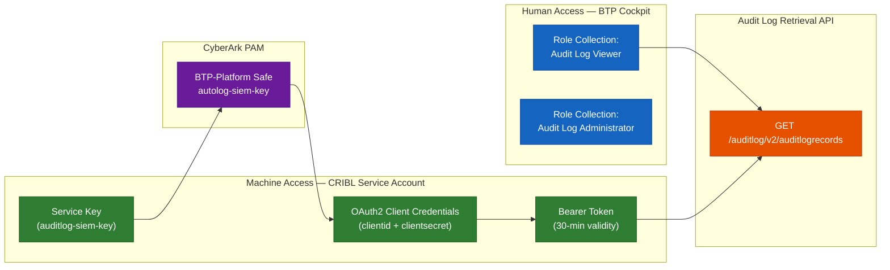
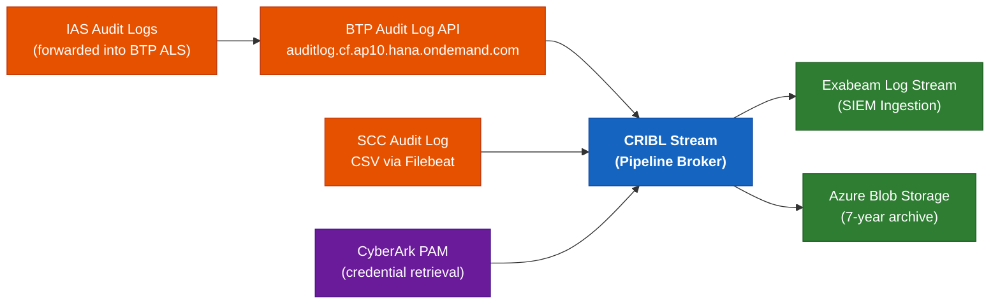
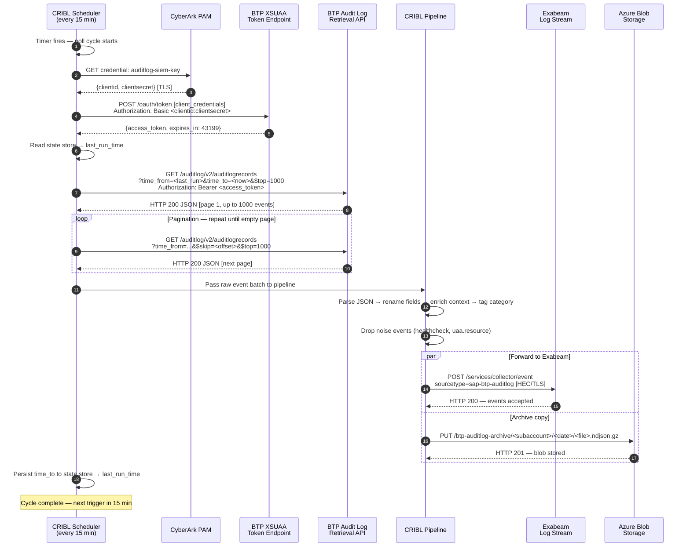
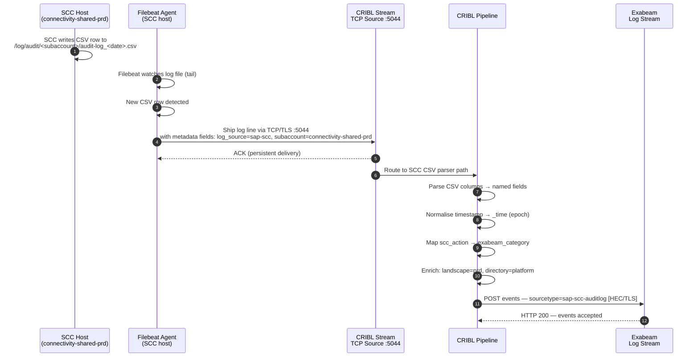
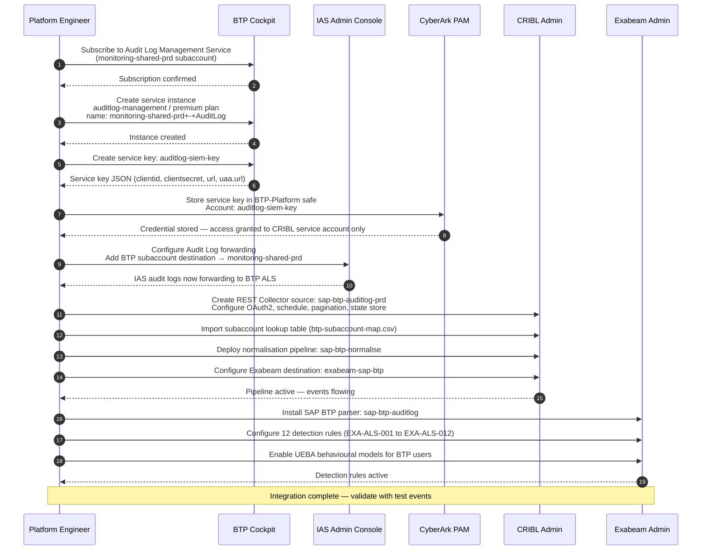

# SAP BTP Audit Log Service — Consumption, RBAC & SIEM Integration
## CRIBL + Exabeam Reference Architecture

> **Document intent**: Provides the technical specification for consuming the SAP BTP Audit Log Service as a security control, including the full authorisation and RBAC model, and the end-to-end integration pipeline from BTP through CRIBL into Exabeam.
> All content is ready for direct insertion into an ADO Wiki page or customer solution design document.

---

## Contents

1. [Audit Log Service Overview](#1-audit-log-service-overview)
2. [Authorisation and RBAC Model](#2-authorisation-and-rbac-model)
3. [CRIBL Integration Architecture](#3-cribl-integration-architecture)
4. [Exabeam Integration Architecture](#4-exabeam-integration-architecture)
5. [Sequence Diagrams](#5-sequence-diagrams)
6. [Operational Controls and Runbook](#6-operational-controls-and-runbook)

---

# 1. Audit Log Service Overview

## 1.1 What the Service Captures

The **SAP BTP Audit Log Service** is a platform-native service that captures security-relevant events generated by SAP BTP platform services, custom applications deployed on BTP, and connected SAP cloud services (IAS, IPS). It operates as the primary compliance and forensic logging control for the BTP platform layer.

Events are categorised into four immutable audit log categories:

| Category | API Filter Value | What is logged | Compliance relevance |
|---|---|---|---|
| **Security Events** | `audit.security-events` | Login / logout events; failed authentication attempts; token issuance (`TokenIssuedEvent`); unauthorised access attempts; account lockout; MFA step-up; XSUAA token policy changes | SOC 2, ISO 27001, RBNZ BS11 |
| **Configuration Events** | `audit.configuration` | Role Collection assignments and removals; trust configuration changes (IdP add/remove); subaccount entitlement changes; service instance creation/deletion; Destination Service modifications; SCC subaccount pairing | SOC 2, RBNZ BS11, PCI-DSS |
| **Data Access Events** | `audit.data-access` | Read access to sensitive personal data in BTP-hosted applications; access to Credential Store entries; Audit Log retrieval API calls | NZ Privacy Act 2020, GDPR |
| **Data Modification Events** | `audit.data-modification` | Writes/updates to sensitive personal data in BTP-hosted applications; Credential Store create/update/delete operations | NZ Privacy Act 2020, GDPR |

> **Note on SCC Audit Logs**: SAP Cloud Connector maintains its own file-based audit log (CSV format at `<scc_root>/log/audit/<subaccount>/audit-log_<date>.csv`). These are NOT automatically forwarded to the BTP Audit Log Service. A separate Filebeat agent is required to ship SCC logs into CRIBL. See Section 3.5.

> **Note on IAS Audit Logs**: SAP IAS maintains its own audit log in a separate store. IAS must be explicitly configured to forward its audit logs to the BTP Audit Log Service in a designated BTP subaccount. See Section 1.4.

---

## 1.2 Service Plans

| Plan | Cost model | Default retention | Configurable retention | Recommended use |
|---|---|---|---|---|
| `free` | Free tier | 90 days | No | Non-production exploration only |
| `oauth2` (standard) | BTPEA credits | 90 days | No | DEV / QAS landscapes |
| `premium` | BTPEA credits (higher) | 90 days | Yes — up to 7 years via support ticket | **PRD landscape — required for compliance** |

> **Recommendation**: Use the `premium` plan in the `monitoring-shared-prd` subaccount and configure a **2-year** hot retention period via SAP support ticket to align with RBNZ BS11 operational risk record-keeping requirements. Archive to Azure Blob Storage for the 7-year regulatory retention tail.

---

## 1.3 What Must Be Provisioned to Consume the Service

The following steps are required in each subaccount from which audit logs must be collected. In the target architecture, the canonical audit log collection subaccount is `monitoring-shared-prd`, but the service instance must also exist in each subaccount that generates events.

### Step-by-step provisioning

| Step | Action | Where | Notes |
|---|---|---|---|
| **1** | Subscribe to `Audit Log Management Service` | BTP Cockpit → Subaccount → Services | Subscribe in **each** subaccount that generates audit events |
| **2** | Create service instance | Service Marketplace → `auditlog-management` plan `premium` | Instance name: `monitoring-shared-prd+-+AuditLog` |
| **3** | Create service key | Instance → Service Keys → Create | Key name: `auditlog-siem-key` — stores OAuth2 credentials |
| **4** | Store service key in CyberArk | CyberArk → BTP-Platform safe | The key contains `clientid`, `clientsecret`, `url`, `uaa.url` |
| **5** | Configure IAS audit log forwarding | IAS Admin Console → Monitoring & Reporting → Audit and Change Logs | Link IAS to the BTP subaccount where ALS instance exists |
| **6** | Validate API access | Test OAuth2 token retrieval + API call (see Section 2.4) | Confirm events are visible before CRIBL onboarding |
| **7** | Configure CRIBL REST source | CRIBL → Sources → REST Collector | See Section 3 for full config |
| **8** | Configure Exabeam parser | Exabeam → Log Stream → Parser Library | See Section 4 for field mapping |

---

## 1.4 IAS Audit Log Forwarding Configuration

SAP IAS must be explicitly configured to forward authentication and identity management events into the BTP Audit Log Service.

```
IAS Admin Console:
  → Applications & Resources
    → Tenant Settings
      → Audit and Change Logs
        → [Click "Add"]
          → BTP Subaccount: [select subaccount with ALS instance]
          → Subaccount API Endpoint: https://<subdomain>.authentication.<region>.hana.ondemand.com
          → Client ID: [from ALS service key uaa.clientid]
          → Client Secret: [from ALS service key uaa.clientsecret — retrieve from CyberArk]
```

Once configured, the following IAS-specific event types are forwarded:

| IAS event | ALS category | Example trigger |
|---|---|---|
| Successful login via SAML/OIDC | `audit.security-events` | User SSO to BTP |
| Failed login attempt | `audit.security-events` | Wrong password / MFA failure |
| Risk-based step-up triggered | `audit.security-events` | Login from unknown IP |
| User account created / updated | `audit.configuration` | IPS provisioning job |
| User group assignment changed | `audit.configuration` | Role Collection change via IPS |
| Corporate IdP (Entra ID) federation changed | `audit.configuration` | Trust config modification |
| Personal data read | `audit.data-access` | Admin views user profile |

> **Retention**: IAS audit log events forwarded to BTP ALS are subject to the ALS retention policy (90 days standard; configurable under premium plan).

---

## 1.5 Audit Log API Reference

The BTP Audit Log Retrieval API is a REST API exposed per subaccount. CRIBL calls this API on a scheduled interval.

### Base URL (Cloud Foundry regions)

| Region | API base URL |
|---|---|
| AWS Sydney (ap10) | `https://auditlog.cf.ap10.hana.ondemand.com` |
| Azure Sydney (ap21) | `https://auditlog.cf.ap21.hana.ondemand.com` |

### Endpoint

```
GET /auditlog/v2/auditlogrecords
```

### Query parameters

| Parameter | Type | Required | Description |
|---|---|---|---|
| `time_from` | ISO 8601 datetime | Yes | Start of the query window: `2026-10-01T00:00:00Z` |
| `time_to` | ISO 8601 datetime | Yes | End of the query window |
| `$filter` | OData filter string | No | Filter by category: `$filter=Category eq 'audit.security-events'` |
| `$top` | Integer | No | Max records to return (default: 1000; max: 1000) |
| `$skip` | Integer | No | Pagination offset |

### Request headers

```
Authorization: Bearer <access_token>
Content-Type: application/json
```

### Sample response record

```json
{
  "uuid": "a1b2c3d4-e5f6-7890-abcd-ef1234567890",
  "user": "john.smith@asb.co.nz",
  "time": "2026-10-12T08:23:41.123Z",
  "tenant": "asb-bank-nz-monitoring-shared-prd",
  "orgId": null,
  "spaceId": null,
  "category": "audit.security-events",
  "message": {
    "type": "TokenIssuedEvent",
    "uuid": "a1b2c3d4-e5f6-7890-abcd-ef1234567890",
    "user": { "id": "john.smith@asb.co.nz", "idp": "https://asb.accounts.ondemand.com" },
    "ip": "203.0.113.45",
    "attributes": [{ "name": "grantType", "value": "authorization_code" }]
  }
}
```

---


---

# 2. Authorisation and RBAC Model

## 2.1 Authorization Architecture Overview

The BTP Audit Log Service uses a **layered authorization model** with three distinct access paths:



---

## 2.2 Human Access — Role Collections

The following BTP Role Collections govern human access to the Audit Log Service. All assignments must be made in the `monitoring-shared-prd` subaccount (and replicated to DEV/QAS for those landscapes).

| Role Collection | Included Roles | Permissions | Assigned Persona | Provisioning path |
|---|---|---|---|---|
| `Audit Log Viewer` | `AuditLogViewer` | **Read** audit log records via the Cockpit Audit Log Viewer UI; call the Audit Log Retrieval API using personal OAuth2 token (not service key) | Security Analyst, CISO, Compliance Auditor | SailPoint → IAS Group `BTP-AuditLog-Viewer` → IPS → XSUAA Role Collection |
| `Audit Log Administrator` | `AuditLogServiceAdministrator` | Configure audit log retention settings; manage the service plan upgrade/downgrade; view billing/usage metrics | Platform Engineer (Senior), Security Architect | SailPoint → IAS Group `BTP-AuditLog-Admin` → IPS → XSUAA Role Collection |
| `Subaccount Administrator` | `Subaccount_Admin` | Full subaccount admin including audit log service management | Platform Engineer — Global | SailPoint → IAS Group `BTP-SA-Admin-PRD` → IPS → XSUAA Role Collection (HIGH RISK) |

> **SoD Requirement**: The persona holding `Audit Log Administrator` must NOT hold `Subaccount Administrator` in the same subaccount — this would allow a single user to both modify the platform AND suppress audit records. Enforce this as SoD policy **SoD-04** in SailPoint.

---

## 2.3 Machine Access — Service Key Authorization

CRIBL authenticates to the BTP Audit Log API using **OAuth2 Client Credentials** derived from a dedicated service key. This is the only machine-to-BTP authentication pattern supported by the Audit Log Retrieval API.

### Service key structure

When a service key is created against the `auditlog-management` instance, BTP generates the following credential object:

```json
{
  "uaa": {
    "clientid": "sb-auditlog-management!b<unique_id>",
    "clientsecret": "<auto-generated-secret>",
    "url": "https://<subdomain>.authentication.ap10.hana.ondemand.com",
    "identityzone": "<subdomain>",
    "tenantid": "<tenant-guid>",
    "tenantmode": "dedicated",
    "verificationkey": "-----BEGIN PUBLIC KEY-----\n...",
    "xsappname": "auditlog-management!b<unique_id>",
    "zoneid": "<zone-guid>"
  },
  "url": "https://auditlog.cf.ap10.hana.ondemand.com"
}
```

| Field | Description | Where used |
|---|---|---|
| `uaa.clientid` | OAuth2 client ID for token request | CRIBL OAuth2 source configuration |
| `uaa.clientsecret` | OAuth2 client secret | CyberArk vault → retrieved by CRIBL at runtime |
| `uaa.url` | Token endpoint base URL | Append `/oauth/token` for token request |
| `url` | Audit Log API base URL | CRIBL REST source target URL |
| `uaa.verificationkey` | Public key for JWT signature verification | Optional — used for local token validation |

### Token request (CRIBL executes this)

```
POST https://<subdomain>.authentication.ap10.hana.ondemand.com/oauth/token
Content-Type: application/x-www-form-urlencoded
Authorization: Basic <base64(clientid:clientsecret)>

grant_type=client_credentials
```

**Token response:**

```json
{
  "access_token": "eyJhbGciOiJSUzI1NiIsInR5cCI6IkpXVCJ9...",
  "token_type": "Bearer",
  "expires_in": 43199,
  "scope": "uaa.resource auditlog.read",
  "jti": "<token-id>"
}
```

> **Token validity**: 43,199 seconds (~12 hours). CRIBL must request a new token before expiry. Token caching is recommended to avoid rate limits.

### JWT claims relevant to audit log access

| Claim | Value | Purpose |
|---|---|---|
| `scope` | `auditlog.read uaa.resource` | Grants read access to audit log records |
| `sub` | Service principal ID | Identifies the CRIBL service account in audit records |
| `iss` | `https://<subdomain>.authentication.ap10.hana.ondemand.com/oauth/token` | Token issuer — validated by BTP |
| `zid` | Tenant zone ID | Restricts access to the correct BTP subaccount |
| `exp` | Unix timestamp | Token expiry — CRIBL must refresh before this time |

---

## 2.4 Service Key Security Controls

| Control | Implementation | Owner |
|---|---|---|
| **Storage** | Service key stored in CyberArk `BTP-Platform` safe, account `auditlog-siem-key` | CyberArk Admin |
| **Rotation** | Service key rotated every 90 days; old key deleted after CRIBL cutover confirmed | Platform Engineering |
| **Access** | Only CRIBL service account and Platform Engineering (break-glass) can retrieve from CyberArk safe | CyberArk Admin |
| **Audit trail** | CyberArk logs all retrievals of `auditlog-siem-key` — forward to Exabeam via existing CyberArk→Exabeam pipeline | CyberArk Admin |
| **Revocation** | If CRIBL is compromised — delete service key immediately in BTP Cockpit → Service Instances → Service Keys → Delete | Platform Engineering (immediate SLA) |
| **SoD** | The CRIBL service account must never hold a human-facing BTP Role Collection (zero user context) | Security Architect |

---

## 2.5 IAS Authorization for Audit Log Forwarding

When IAS forwards its audit logs to BTP ALS, a separate OAuth2 trust is established between the IAS tenant and the BTP subaccount. This trust uses an **IAS application** (of type "SAP BTP") registered in the IAS admin console and a **dedicated OAuth2 client** scoped only to the audit log forwarding function.

```
IAS Admin Console:
  → Applications & Resources → Applications → [Create new]
    Application Name: BTP-AuditLog-Forwarder
    Type: SAP BTP
    Client Authentication: Client Secret
    Scopes: [auto-assigned by BTP ALS binding]
```

The forwarding connection does NOT use the same `auditlog-siem-key` as CRIBL. It is a separate trust relationship managed entirely within IAS and BTP IAM — CRIBL reads the combined event stream from BTP ALS after forwarding occurs.

---

## 2.6 RBAC Matrix — Audit Log Service

| Persona | IAS Group | BTP Role Collection | Access type | Provisioned by |
|---|---|---|---|---|
| Security Analyst | `BTP-AuditLog-Viewer` | `Audit Log Viewer` | Read — UI Viewer + personal OAuth2 token | SailPoint → IPS → XSUAA |
| CISO | `BTP-AuditLog-Viewer` | `Audit Log Viewer` | Read — UI Viewer | SailPoint → IPS → XSUAA |
| Compliance Auditor | `BTP-AuditLog-Viewer` | `Audit Log Viewer` | Read — UI Viewer (time-limited) | SailPoint → IPS → XSUAA (time-limited access request) |
| Platform Engineer (Senior) | `BTP-AuditLog-Admin` | `Audit Log Administrator` | Config — retention, plan | SailPoint → IPS → XSUAA |
| CRIBL Service Account | N/A — service key only | N/A | Machine — OAuth2 client credentials via service key | Service key in CyberArk — no SailPoint provisioning |
| Break-Glass Admin | `BTP-SA-Admin-PRD` | `Subaccount Administrator` | Emergency — full SA admin | CyberArk break-glass procedure — not SailPoint |

---

## 2.7 Audit Log of the Audit Log

A critical control: access to the Audit Log API must itself be audited. Every call to `GET /auditlog/v2/auditlogrecords` generates an `audit.data-access` event in the Audit Log Service. This creates a **self-referencing audit trail** that verifies:

1. CRIBL is polling at the expected cadence (absent events = potential CRIBL failure or log tampering)
2. No unexpected actors are querying audit logs (detect lateral movement by credential theft)
3. The `sub` (subject) in all API access records matches the CRIBL service principal ID

This self-referencing audit trail must be included in the Exabeam detection rule **EXA-ALS-005: Unexpected Audit Log API Consumer** (see Section 4.3).

---


---

# 3. CRIBL Integration Architecture

## 3.1 CRIBL Role in the Pipeline

**CRIBL Stream** acts as the **observability pipeline broker** between the BTP Audit Log API and Exabeam. Its responsibilities in this architecture are:

- **Collect**: Poll the BTP Audit Log Retrieval API on a scheduled interval with incremental read logic
- **Collect (SCC)**: Receive SCC file-based audit logs via Filebeat → CRIBL TCP/Syslog source
- **Transform**: Normalise BTP JSON event schema to the Exabeam-compatible field naming convention
- **Enrich**: Add environment context fields (`landscape`, `btpSubaccount`, `btpDirectory`)
- **Route**: Forward enriched events to Exabeam Log Stream; optionally fork a copy to Azure Blob Storage for long-term archival
- **Backpressure management**: Buffer events during Exabeam unavailability; replay on recovery



---

## 3.2 CRIBL Source — BTP Audit Log REST Collector

CRIBL uses a **REST API Collector** (scheduled HTTP source) to poll the BTP Audit Log API.

### Source configuration parameters

| Parameter | Value | Notes |
|---|---|---|
| **Source type** | REST Collector (scheduled) | Built-in CRIBL source type |
| **Source name** | `sap-btp-auditlog-prd` | One source per landscape (dev, qa, prd) |
| **Schedule** | `*/15 * * * *` (every 15 minutes) | Adjust to `*/5` for near-real-time in PRD |
| **Authentication type** | OAuth2 Client Credentials | |
| **Token URL** | `https://<subdomain>.authentication.ap10.hana.ondemand.com/oauth/token` | From service key `uaa.url` + `/oauth/token` |
| **Client ID** | `sb-auditlog-management!b<id>` | Retrieved from CyberArk at CRIBL startup |
| **Client Secret** | `<secret>` | Retrieved from CyberArk — not hardcoded |
| **Target URL** | `https://auditlog.cf.ap10.hana.ondemand.com/auditlog/v2/auditlogrecords` | From service key `url` |
| **HTTP method** | `GET` | |
| **Pagination** | Enabled — `$skip` / `$top` (1000 per page) | Loop until empty page |
| **State store** | CRIBL internal KV store — stores `last_time_to` | Enables incremental reads |
| **Backoff on 429** | 60 seconds, max 3 retries | BTP ALS rate limiting |
| **TLS verify** | Enabled | Required — BTP uses valid SAP CA |

### Incremental read logic

CRIBL must track the last successfully processed timestamp to avoid re-ingesting events or creating gaps. The following logic must be implemented in the CRIBL REST Collector pre/post-process scripts:

```javascript
// Pre-process: Build time window for this poll cycle
const WINDOW_MINUTES = 15;
const now = new Date();
const lastRun = cribl.state.get('btp_als_last_run') || new Date(now - 86400000).toISOString(); // default: 24h ago on first run

const timeFrom = lastRun;
const timeTo = now.toISOString();

cribl.params.set('time_from', timeFrom);
cribl.params.set('time_to', timeTo);
```

```javascript
// Post-process: Persist the time_to for the next cycle
cribl.state.set('btp_als_last_run', cribl.params.get('time_to'));
```

> **Gap protection**: If CRIBL is restarted, the state store persists `btp_als_last_run`. On restart, CRIBL will pick up from the last successful poll time, ensuring no audit log gaps.

---

## 3.3 CRIBL Source — SCC Audit Log (Filebeat → CRIBL TCP)

SAP Cloud Connector writes audit events to a local CSV file. A **Filebeat agent** installed on the SCC host ships these files to CRIBL via TCP/TLS.

### Filebeat configuration on SCC host (`filebeat.yml`)

```yaml
filebeat.inputs:
  - type: log
    enabled: true
    paths:
      - /opt/scc/log/audit/*/audit-log_*.csv
    fields:
      log_source: sap-scc
      landscape: prd
      subaccount: connectivity-shared-prd
    fields_under_root: true
    multiline:
      pattern: '^\d{4}-\d{2}-\d{2}'
      negate: true
      match: after

output.logstash:
  hosts: ["<cribl-stream-host>:5044"]
  ssl.enabled: true
  ssl.certificate_authorities: ["/etc/filebeat/cribl-ca.pem"]
```

### CRIBL TCP/Syslog receiver for Filebeat

| Parameter | Value |
|---|---|
| **Source type** | Elastic/Filebeat (TCP) |
| **Port** | 5044 |
| **TLS** | Enabled — mutual TLS with Filebeat client certificate |
| **Source name** | `sap-scc-auditlog` |
| **Parsing** | CSV parser — see Section 3.4 |

### SCC CSV field mapping

SCC audit log CSV format:

```csv
"2026-10-12 08:23:41","SECURITY","john.smith@asb.co.nz","HTTP","GET","/api/v1/resource","200","REQUEST_PROCESSED","connectivity-shared-prd"
```

| CSV column index | Field name | Description |
|---|---|---|
| 0 | `scc_timestamp` | Event timestamp |
| 1 | `scc_event_level` | `SECURITY`, `ALL`, `CONFIG` |
| 2 | `scc_user` | User or service account triggering the event |
| 3 | `scc_protocol` | Protocol used (HTTP, RFC, LDAP, TCP) |
| 4 | `scc_method` | HTTP method or RFC function |
| 5 | `scc_resource` | Resource path or function module name |
| 6 | `scc_status` | HTTP status code or result code |
| 7 | `scc_action` | Audit action category |
| 8 | `scc_subaccount` | BTP subaccount name |

---

## 3.4 CRIBL Pipeline — Normalisation and Enrichment

A single CRIBL pipeline (`sap-btp-normalise`) processes events from both the BTP ALS REST source and the SCC Filebeat source.

### Pipeline stages

| Stage | Type | Purpose |
|---|---|---|
| **1. Source router** | Route | Detect source: `log_source == 'sap-scc'` → SCC path; else → BTP ALS path |
| **2a. BTP ALS JSON parse** | Eval | Extract fields from BTP ALS JSON response body |
| **2b. SCC CSV parse** | Regex / CSV | Parse SCC CSV row into named fields |
| **3. Timestamp normalise** | Eval | Convert all timestamps to `_time` (Unix epoch) |
| **4. Field rename** | Rename | Rename BTP fields to Exabeam Common Event Format |
| **5. Context enrich** | Lookup / Eval | Add `btpDirectory`, `btpSubaccount`, `landscape`, `btpRegion` |
| **6. Category tag** | Eval | Map `category` → Exabeam `event_type` tag |
| **7. Drop internal noise** | Drop | Drop `healthcheck` pings and `uaa.resource` self-check calls |
| **8. Output router** | Route | Forward to Exabeam destination + Azure Blob fork |

### Field normalisation map (BTP ALS → Exabeam)

| BTP ALS field | Exabeam field | Notes |
|---|---|---|
| `message.user.id` | `src_user` | Initiating user identity |
| `user` | `src_user` | Fallback if `message.user.id` absent |
| `message.ip` | `src_ip` | Source IP of the event |
| `time` | `_time` | Normalised to Unix epoch |
| `category` | `event_category` | BTP category value |
| `message.type` | `event_type` | Specific event type (e.g. `TokenIssuedEvent`) |
| `tenant` | `btpSubaccount` | BTP subaccount name |
| `uuid` | `event_id` | Unique event identifier |
| `message.attributes` | `raw_attributes` | Raw attribute array — stringify as JSON |
| *(enriched)* | `landscape` | `dev` / `qa` / `prd` — from CRIBL lookup |
| *(enriched)* | `btpDirectory` | `integration` / `platform` etc — from CRIBL lookup |
| *(enriched)* | `btpRegion` | `ap10` or `ap21` — from source config |
| *(enriched)* | `log_source` | `sap-btp-als` or `sap-scc` |

### CRIBL pipeline pseudo-code (Eval stage — field normalisation)

```javascript
// Stage 4 — Field rename and normalisation
__e['src_user']       = __e['message.user.id'] || __e['user'] || 'unknown';
__e['src_ip']         = __e['message.ip'] || null;
__e['event_category'] = __e['category'];
__e['event_type']     = __e['message.type'] || __e['scc_action'] || 'generic';
__e['event_id']       = __e['uuid'];
__e['_time']          = new Date(__e['time']).getTime() / 1000;

// Stage 5 — Context enrichment
__e['landscape']      = cribl.lookup('btp-subaccount-map', __e['btpSubaccount'], 'landscape') || 'unknown';
__e['btpDirectory']   = cribl.lookup('btp-subaccount-map', __e['btpSubaccount'], 'directory') || 'unknown';
__e['btpRegion']      = 'ap10'; // Set per source config

// Stage 6 — Category tag for Exabeam event type
const catMap = {
  'audit.security-events'   : 'authentication',
  'audit.configuration'     : 'configuration-change',
  'audit.data-access'       : 'data-access',
  'audit.data-modification' : 'data-modification'
};
__e['exabeam_category'] = catMap[__e['event_category']] || 'other';

// Stage 7 — Drop noise
if (__e['event_type'] === 'healthcheck' || __e['src_user'] === 'uaa.resource') {
    __e['__criblSkip'] = true;
}
```

---

## 3.5 CRIBL Destination — Exabeam Log Stream

| Parameter | Value | Notes |
|---|---|---|
| **Destination type** | Syslog (TCP/TLS) or HTTP Event Collector | Use HTTP if Exabeam Log Stream supports HEC endpoint |
| **Destination name** | `exabeam-sap-btp` | |
| **Host** | `<exabeam-logstream-host>` | Customer-managed Exabeam environment |
| **Port** | `514` (Syslog TLS) or `8088` (HEC) | Confirm with Exabeam team |
| **TLS** | Enabled | Mutual TLS recommended |
| **Format** | JSON (structured syslog or HEC payload) | |
| **Backpressure policy** | Persistent Queue — 10 GB disk buffer | Replay on Exabeam recovery |
| **Metadata fields** | `sourcetype: sap-btp-auditlog` | Set for Exabeam parser routing |

---

## 3.6 CRIBL Destination — Azure Blob Storage (Long-term Archive)

A fork of every event is sent to Azure Blob Storage for the 7-year regulatory retention tail.

| Parameter | Value |
|---|---|
| **Destination type** | Azure Blob Storage |
| **Container** | `btp-auditlog-archive` |
| **Path expression** | `btpauditlogs/${btpSubaccount}/${Year}/${Month}/${Day}/` |
| **Format** | Compressed NDJSON (`.ndjson.gz`) — 100 MB file rotation |
| **Authentication** | Managed Identity (CRIBL host MSI) or SAS token from CyberArk |
| **Retention policy** | 7 years (enforced by Azure Blob Storage immutability policy) |

---

## 3.7 CRIBL Lookup Table — Subaccount Context Map

CRIBL uses a static lookup table (`btp-subaccount-map`) to enrich events with directory and landscape context. This table must be updated when new subaccounts are provisioned.

```csv
subaccount,directory,landscape,owner
integration-shared-dev,integration,dev,Integration Engineering
integration-shared-qa,integration,qa,Integration Engineering
integration-shared-prd,integration,prd,Integration Engineering
integration-core-dev,integration,dev,Integration Engineering
application-core-dev,application,dev,Application Engineering
application-core-qa,application,qa,Application Engineering
application-core-prd,application,prd,Application Engineering
application-shared-dev,application,dev,Application Engineering
analytics-shared-dev,analytics,dev,Analytics Engineering
analytics-core-dev,analytics,dev,Analytics Engineering
analytics-shared-qa,analytics,qa,Analytics Engineering
analytics-shared-prd,analytics,prd,Analytics Engineering
security-shared-platform,platform,platform,Platform Engineering
security-shared-dev,platform,dev,Platform Engineering
security-shared-qa,platform,qa,Platform Engineering
security-shared-prd,platform,prd,Platform Engineering
monitoring-shared-prd,platform,prd,Platform Engineering
deployment-shared-prd,platform,prd,Platform Engineering
connectivity-shared-dev,platform,dev,Platform Engineering
connectivity-shared-qa,platform,qa,Platform Engineering
connectivity-shared-prd,platform,prd,Platform Engineering
```

---


---

# 4. Exabeam Integration Architecture

## 4.1 Exabeam Role in the Pipeline

**Exabeam** serves as the **SIEM and User Entity Behaviour Analytics (UEBA)** platform. It receives normalised BTP audit log events from CRIBL and provides:

- **Log ingestion and storage** via Exabeam Log Stream / Data Lake
- **Behavioural baselines** — learns normal patterns for BTP personas and detects anomalies
- **Correlation rules** — fires alerts on specific BTP threat scenarios
- **Incident timelines** — aggregates BTP events with events from other systems (Entra ID, CyberArk, S/4HANA) into user-centric activity timelines
- **Case management** — creates tickets in the SOC workflow system for high-priority BTP alerts

---

## 4.2 Exabeam Parser — SAP BTP Audit Log

Exabeam requires a **log parser** to correctly classify and extract fields from BTP audit log events arriving from CRIBL. The parser maps the CRIBL-normalised JSON to Exabeam Data Model (EDM) fields.

### Parser definition

| Parser attribute | Value |
|---|---|
| **Parser name** | `sap-btp-auditlog` |
| **Source type** | `sap-btp-auditlog` (set in CRIBL destination metadata) |
| **Vendor** | SAP |
| **Product** | SAP BTP |
| **Log format** | JSON |
| **Timestamp field** | `_time` (Unix epoch — already normalised by CRIBL) |

### Exabeam field mapping

| Exabeam EDM field | Source field (post-CRIBL) | Notes |
|---|---|---|
| `user` | `src_user` | Primary actor identity (email format) |
| `src_ip` | `src_ip` | Source IP of event |
| `event_type` | `exabeam_category` | `authentication`, `configuration-change`, `data-access`, `data-modification` |
| `outcome` | Derived from `event_type` | `TokenIssuedEvent` → `success`; failed login → `failure` |
| `src_host` | `btpSubaccount` | Source context — BTP subaccount |
| `dest_host` | `btpDirectory` | Destination context — BTP directory |
| `app` | `log_source` | `sap-btp-als` or `sap-scc` |
| `event_id` | `event_id` | Unique BTP event UUID |
| `additional_info` | `raw_attributes` | Stringified JSON of BTP event attributes |
| `session_id` | `message.grantType` + `src_user` | Composite session context |
| `environment` | `landscape` | `dev` / `qa` / `prd` |
| `product` | `btpRegion` | `ap10` or `ap21` |

---

## 4.3 Exabeam Detection Rules — BTP Audit Log

The following detection rules must be configured in Exabeam for BTP audit log events. Each rule maps to a specific threat scenario.

| Rule ID | Rule Name | Trigger condition | STRIDE category | Severity | Response action |
|---|---|---|---|---|---|
| **EXA-ALS-001** | BTP Role Collection Privilege Escalation | `event_type = 'configuration-change'` AND `raw_attributes` contains `GlobalAccountAdministrator` or `SubaccountAdministrator` | Elevation of Privilege | **Critical** | Page SOC; create P1 incident; notify CISO |
| **EXA-ALS-002** | BTP Authentication Brute Force | `event_type = 'authentication'` AND `outcome = 'failure'` count > 5 in 10 minutes for same `src_user` | Spoofing | **High** | Alert SOC; flag user in Exabeam; notify Identity team |
| **EXA-ALS-003** | BTP Login from Unexpected Geography | `event_type = 'authentication'` AND `outcome = 'success'` AND `src_ip` geo-lookup NOT IN `[NZ, AU]` | Spoofing | **High** | Alert SOC; cross-reference with Entra ID sign-in logs |
| **EXA-ALS-004** | BTP Trust Configuration Modified | `event_type = 'configuration-change'` AND `raw_attributes` contains `trustConfiguration` or `identityProvider` | Tampering | **Critical** | Page SOC; create P1 incident; immediate review |
| **EXA-ALS-005** | Unexpected Audit Log API Consumer | `log_source = 'sap-btp-als'` AND `event_type = 'data-access'` AND `src_user` NOT IN `['sb-auditlog-management!b<id>']` | Repudiation / Information Disclosure | **High** | Alert SOC; investigate unauthorized credential use |
| **EXA-ALS-006** | Audit Log Gap Detected | No BTP ALS events received for > 20 minutes (expected cadence: every 15 min) | Repudiation / Tampering | **High** | Alert SOC; check CRIBL pipeline health; page Platform Engineering |
| **EXA-ALS-007** | BTP Credential Store Access Spike | `event_type = 'data-access'` AND `btpSubaccount` contains `security-shared` count > 20 in 5 minutes | Information Disclosure | **High** | Alert SOC; review Credential Store access patterns |
| **EXA-ALS-008** | SCC Subaccount Pairing Changed | `log_source = 'sap-scc'` AND `scc_action = 'CONFIG'` AND `scc_resource` contains `subaccount` | Tampering | **Critical** | Page SOC; create P1 incident; notify Platform Engineering |
| **EXA-ALS-009** | BTP Destination Modified | `event_type = 'configuration-change'` AND `raw_attributes` contains `destination` | Tampering | **Medium** | Alert SOC; review change against ITSM change record |
| **EXA-ALS-010** | Break-Glass Account Activity | `src_user` matches `break-glass-*` pattern AND any BTP event | Elevation of Privilege | **Critical** | Page SOC; notify CISO; require post-activity review |
| **EXA-ALS-011** | Mass User Deprovisioning | `event_type = 'configuration-change'` AND `raw_attributes` contains `roleCollection` AND count > 10 unique users in 5 minutes | Tampering | **High** | Alert SOC; correlate with SailPoint events; investigate IPS job |
| **EXA-ALS-012** | Off-Hours Platform Admin Activity | `event_type = 'configuration-change'` AND `_time` outside business hours (NZT 07:00–19:00) AND `src_user` in Platform Admin group | Elevation of Privilege | **Medium** | Alert SOC; correlate with approved change records |

---

## 4.4 Exabeam UEBA Behavioural Models

In addition to rule-based detection, Exabeam's UEBA engine builds behavioural baselines for BTP users. The following activity types feed UEBA models:

| UEBA model | BTP event source | Baseline behaviour | Anomaly trigger |
|---|---|---|---|
| **Login time baseline** | `audit.security-events` — `TokenIssuedEvent` | Normal login hours per user | Login at unusual hour |
| **Login location baseline** | `audit.security-events` — `TokenIssuedEvent` + `src_ip` | Normal IP ranges and geographies per user | Login from new location |
| **Admin action frequency** | `audit.configuration` | Expected config change rate per admin | Spike in configuration changes |
| **Role assignment pattern** | `audit.configuration` — role collection events | Normal provisioning frequency | Bulk role assignments outside IPS provisioning window |
| **API access pattern** | `audit.data-access` | Normal CRIBL polling signature | New service account or user accessing ALS API |

---

# 5. Sequence Diagrams

## 5.1 CRIBL OAuth2 Token Acquisition and BTP ALS Poll (Recurring)



---

## 5.2 SCC Audit Log Filebeat → CRIBL → Exabeam



---

## 5.3 Initial Setup Sequence (One-Time)



---

# 6. Operational Controls and Runbook

## 6.1 Monitoring the Pipeline Health

| Check | Expected result | Alert if violated | Responsible |
|---|---|---|---|
| CRIBL job status | `sap-btp-auditlog-prd` job status = `success` every 15 min | Any `failed` status | Platform Engineering |
| Event volume in Exabeam | Minimum 10 events per 15-min window during business hours | No events for > 20 min → EXA-ALS-006 | SOC |
| SCC Filebeat heartbeat | Filebeat agent reports `alive` every 60 seconds | No heartbeat for > 5 min | Platform Engineering |
| Token expiry | CRIBL refreshes token before 43,200-second expiry | Token refresh failure → poll stops | Platform Engineering |
| Azure Blob archive | New files created hourly in `btp-auditlog-archive` | No new blobs for > 2 hours | Platform Engineering |

## 6.2 Service Key Rotation Runbook

Rotate every 90 days (or immediately on suspected compromise):

1. In BTP Cockpit → `monitoring-shared-prd` → Service Instances → `monitoring-shared-prd+-+AuditLog` → Service Keys → **Create new key** (`auditlog-siem-key-v2`)
2. Store new key in CyberArk safe (`auditlog-siem-key-v2`)
3. Update CRIBL REST source to reference new CyberArk account name
4. Test CRIBL poll — confirm events received in Exabeam
5. In CyberArk, remove old account (`auditlog-siem-key`)
6. In BTP Cockpit → delete old service key (`auditlog-siem-key`)
7. Record completion in ITSM change record

## 6.3 Log Retention Tiers

| Tier | Storage | Retention | Access | Cost driver |
|---|---|---|---|---|
| **Hot** — BTP ALS native | BTP Audit Log Service (premium) | 2 years | Direct API (CRIBL, human via Viewer UI) | BTPEA premium credits |
| **Warm** — Exabeam Data Lake | Exabeam Data Lake | 1 year | Exabeam search and correlation | Exabeam licensing |
| **Cold** — Azure Blob Archive | Azure Blob Storage (Cool/Archive tier) | 7 years | Azure Storage Explorer / scripts | Azure storage costs |

> **Compliance note**: RBNZ BS11 requires operational risk records to be kept for a minimum of 7 years. The Cold tier Azure Blob Storage must be configured with **Azure Immutability Policy (WORM)** to prevent deletion during the retention period.

## 6.4 Quick Reference — Key Values per Landscape

| Parameter | DEV | QAS | PRD |
|---|---|---|---|
| Subaccount | `monitoring-shared-dev` | `monitoring-shared-qa` | `monitoring-shared-prd` |
| ALS instance name | `monitoring-shared-dev+-+AuditLog` | `monitoring-shared-qa+-+AuditLog` | `monitoring-shared-prd+-+AuditLog` |
| ALS plan | `oauth2` (standard) | `oauth2` (standard) | **`premium`** |
| Service key name | `auditlog-siem-key-dev` | `auditlog-siem-key-qa` | `auditlog-siem-key-prd` |
| CyberArk safe | `BTP-Platform-DEV` | `BTP-Platform-QAS` | `BTP-Platform-PRD` |
| CRIBL source name | `sap-btp-auditlog-dev` | `sap-btp-auditlog-qa` | `sap-btp-auditlog-prd` |
| Poll schedule | `*/30 * * * *` (30 min) | `*/30 * * * *` (30 min) | `*/15 * * * *` (15 min) |
| Exabeam retention | 30 days | 90 days | 1 year |
| Azure archive | Not required | Not required | Required — 7 years WORM |

---
