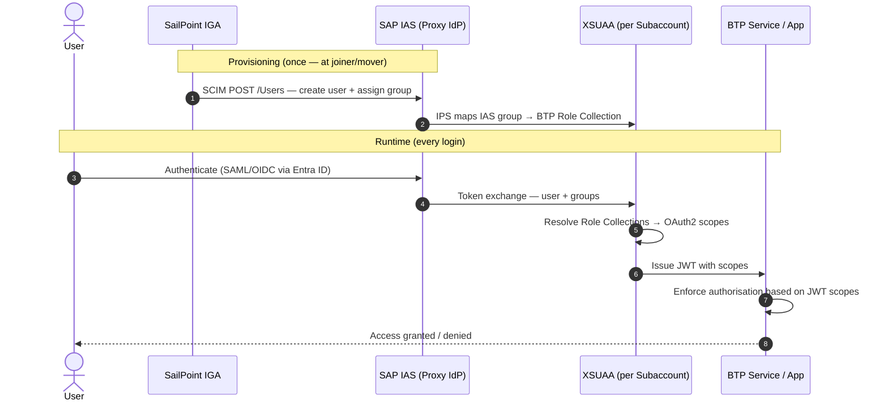
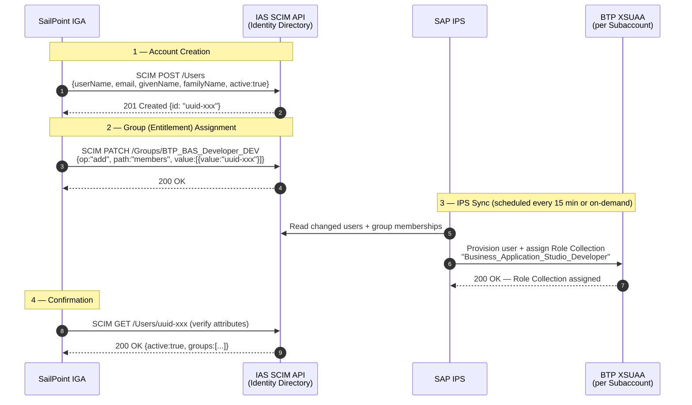
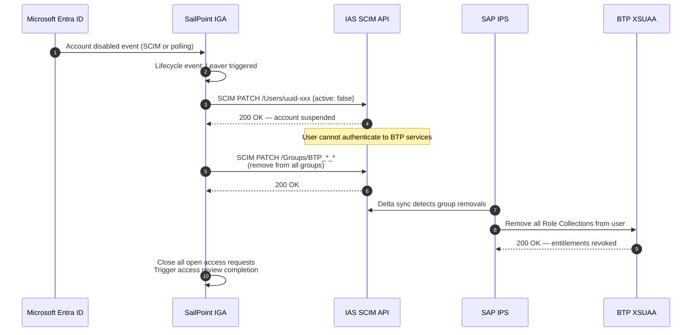

# SAP BTP Platform Foundation — RBAC Model & SailPoint Provisioning Blueprint

| Version | Date | Author | Purpose |
|---|---|---|---|
| 1.0 | [Date] | [Author] | RBAC model for all BTP Foundation services; SailPoint IGA provisioning blueprint |

> **Audience**: SAP BTP Platform Engineering team, SailPoint IGA implementation team, Identity Operations, CISO.
> **Purpose**: Defines every role, role collection, and permission across all SAP BTP Foundation services. Section 4 translates this model directly into SailPoint IGA artefacts — source schema, entitlement catalog, access profiles, business roles, joiner/mover/leaver matrix, and access certification configuration.

---

# Contents

[[_TOC_]]

---

# 1. BTP Authorization Model — Overview

## 1.1 Architecture of BTP Authorization

SAP BTP uses a **layered, federated authorization model**. Authorization decisions are made at multiple levels, each adding a more granular control boundary:

```
┌─────────────────────────────────────────────────────┐
│  Layer 1: Global Account (Platform Admin)           │
│  Controls: who can manage directories, subaccounts  │
│  Role Types: Global Account Administrator / Viewer  │
├─────────────────────────────────────────────────────┤
│  Layer 2: Subaccount (Platform Operations)          │
│  Controls: who can deploy services, manage entitle- │
│  ments, access BTP Cockpit per subaccount           │
│  Role Types: Subaccount Administrator / Viewer      │
├─────────────────────────────────────────────────────┤
│  Layer 3: Service / Application (Workload Access)   │
│  Controls: who can use specific subscribed services │
│  Role Types: Service-specific Role Collections      │
│  (BAS Developer, cTMS ImportOperator, etc.)         │
├─────────────────────────────────────────────────────┤
│  Layer 4: Resource / Instance (Data Access)         │
│  Controls: access to specific service instances,    │
│  bound to applications via service bindings         │
│  Role Types: Instance-level bindings / XSUAA scopes │
└─────────────────────────────────────────────────────┘
```

## 1.2 Authorization Flow — IAS to XSUAA



## 1.3 Role Collection Provisioning Model

BTP Role Collections are the **unit of entitlement** in SailPoint. The provisioning chain is:

```
SailPoint Business Role
    └── Access Profile: BTP-[Persona]
            └── Entitlement: BTP Role Collection (e.g. "Subaccount_Administrator_DEV")
                    └── Provisioned via: IPS SCIM → IAS User Groups → XSUAA Role Collection assignment
```

## 1.4 Key Terms

| Term | Definition |
|---|---|
| **Role Collection** | BTP-level bundle of role templates; the primary entitlement unit |
| **Role Template** | SAP-predefined permission set within a service; combined into Role Collections |
| **IAS Group** | Group in IAS Identity Directory mapped 1:1 to a BTP Role Collection via IPS |
| **Access Profile** | SailPoint object: a named bundle of entitlements for a specific job function |
| **Business Role** | SailPoint object: a bundle of access profiles assigned to an identity by job title or org unit |
| **Entitlement** | SailPoint term for a single permission granted on a managed system (= BTP Role Collection) |
| **Source** | SailPoint term for a connected system being managed (= SAP BTP via IAS SCIM connector) |

---

# 2. BTP Foundation Services — RBAC Reference

> **Naming Convention for Role Collections**
> All customer-created Role Collections follow this naming standard:
> `[Service-Code]_[Role]_[Landscape]`
> Examples: `BAS_Developer_DEV`, `cTMS_ImportOperator_PRD`, `AuditLog_Viewer_ALL`
> SAP-provided Role Collections retain their standard names and are referenced as-is.

---

## 2.1 BTP Account Model (Global Account + Subaccounts)

**Service Description**: The BTP account hierarchy governs access to the BTP Cockpit, subaccount management, entitlement allocation, and directory structure. These are the foundational platform administration roles.

### Platform-Level Role Collections

| Role Collection | Scope | Key Permissions | Assigned Persona | Risk | Provisioning |
|---|---|---|---|---|---|
| `Global Account Administrator` | Global Account | Create/delete subaccounts; allocate entitlements; manage directories; manage global account members; manage trust configurations | Global Account Admin only | 🔴 Critical | SailPoint → IAS → IPS → XSUAA |
| `Global Account Viewer` | Global Account | Read-only view of subaccounts, directories, entitlements, usage reports | CISO Analyst, Platform Viewer | 🟡 Low | SailPoint → IAS → IPS → XSUAA |
| `Subaccount Administrator` (per SA) | Subaccount (DEV / QAS / PRD) | Full control of subaccount: deploy services, configure trust, manage members, manage roles, configure environments | Platform Engineer (scoped per SA) | 🔴 Critical | SailPoint → IAS → IPS → XSUAA |
| `Subaccount Viewer` (per SA) | Subaccount (DEV / QAS / PRD) | Read-only view of all subaccount resources, services, instances | Security Auditor, Release Manager (read) | 🟡 Low | SailPoint → IAS → IPS → XSUAA |

### Segregation of Duties (SoD) Constraints

| SoD Rule | Rule ID | Description |
|---|---|---|
| No cross-landscape SA Admin | SoD-01 | A single identity must not hold `Subaccount Administrator` on both QAS and PRD simultaneously |
| No GA Admin + SA Admin | SoD-02 | Global Account Administrators must not also be Subaccount Administrators — separate identities or emergency break-glass only |
| Viewer roles are additive | SoD-03 | Viewer roles may be held alongside operational roles (e.g. Developer + Viewer is permitted) |

---

## 2.2 SAP Identity Authentication Service (IAS)

**Service Description**: IAS is the BTP-side identity proxy. It federates with Microsoft Entra ID and SailPoint IGA, provides conditional access policies, MFA orchestration, and serves as the token issuer for all BTP authentication flows.

### IAS Admin Console Roles

| IAS Role | Scope | Key Permissions | Assigned Persona | Risk | Assignment Method |
|---|---|---|---|---|---|
| `Administrator` | IAS Tenant (all subaccounts) | Full IAS tenant admin: configure applications, trust providers, risk policies, MFA, audit settings | IAS Administrator only | 🔴 Critical | IAS Admin Console → manual + CyberArk PAM |
| `Manage Applications` | IAS Tenant | Create, configure, and delete application registrations; manage SAML/OIDC settings | IAS Application Admin | 🟠 High | IAS Admin Console |
| `Manage Users` | IAS Tenant | Create, modify, deactivate user records in Identity Directory; reset passwords; manage user attributes | Identity Operations | 🟠 High | IAS Admin Console |
| `Manage Groups` | IAS Tenant | Create, modify, delete user groups; manage group membership | Identity Operations | 🟠 High | IAS Admin Console |
| `Manage Corporate Identity Providers` | IAS Tenant | Register, configure, and manage corporate IdP trust (Entra ID SAML metadata; SailPoint SCIM token) | IAS Admin | 🔴 Critical | IAS Admin Console |
| `Manage Tenant Configuration` | IAS Tenant | Configure tenant-wide settings: password policy, session timeout, locale, branding | IAS Admin | 🟠 High | IAS Admin Console |
| `View All` | IAS Tenant | Read-only view of all IAS tenant configuration, applications, users, groups | Security Auditor | 🟡 Low | IAS Admin Console |
| `Read Tenant Applications` | IAS Tenant | Read-only view of registered applications only | Platform Viewer | 🟡 Low | IAS Admin Console |

> **Note**: IAS admin roles are managed within the IAS Admin Console, not via BTP Cockpit Role Collections. SailPoint does not directly provision IAS admin roles. IAS admin role assignment is manual and vaulted in CyberArk.

---

## 2.3 SAP Identity Provisioning Service (IPS)

**Service Description**: IPS orchestrates user and group provisioning from SailPoint (source) into IAS Identity Directory and BTP Role Collections (targets). It manages the joiner/mover/leaver lifecycle for all BTP platform users.

### IPS Admin Roles

| IPS Role | Scope | Key Permissions | Assigned Persona | Risk | Assignment Method |
|---|---|---|---|---|---|
| `Access Administrator` | IPS Tenant | Full IPS admin: configure source/target systems, run provisioning jobs, view job logs, manage transformation rules | Identity Operations (IPS Admin) | 🔴 Critical | IAS Admin Console → IPS admin role |
| `System Administrator` | IPS Tenant | Manage IPS system settings, certificates, OAuth clients; access all provisioning job controls | Platform Engineer | 🟠 High | IAS Admin Console → IPS admin role |

> **Note**: IPS admin roles are assigned via the IAS Admin Console (IPS is embedded within IAS). SailPoint manages the provisioning data but does not itself manage IPS admin access — IPS admin access is out-of-band via CyberArk-vaulted credentials.

---

## 2.4 SAP Authorization & Trust Management Service (XSUAA)

**Service Description**: XSUAA is the OAuth 2.0 authorization server per BTP subaccount. It issues JWT access tokens containing user identity, Role Collection scopes, and tenant context. Every application-layer role collection is managed through XSUAA.

### XSUAA Role Collections (per subaccount)

| Role Collection | Scope | Key Permissions | Assigned Persona | Risk | Provisioning |
|---|---|---|---|---|---|
| Subaccount Role Collection Admin | Subaccount | Create, modify, assign, and delete custom Role Collections; manage role templates | Platform Engineer | 🔴 Critical | SailPoint → IAS → IPS |
| Subaccount Trust Configuration Admin | Subaccount | Modify XSUAA trust configuration; add or remove trusted IdPs | Platform Engineer | 🔴 Critical | SailPoint → IAS → IPS |

> **Token Policy Defaults (to be reviewed per security baseline)**:
> - Access token validity: **12 hours** (recommended: reduce to 1–4 hours for privileged roles)
> - Refresh token validity: **7 days**
> - Key rotation: Annually minimum; triggered after any security incident

---

## 2.5 SAP Cloud Connector (SCC)

**Service Description**: SCC is an on-premise reverse-proxy agent establishing the HA tunnel between BTP and S/4HANA TRBK. It has its own local role model independent of BTP Cockpit. HA pairs (Master + Shadow) are deployed per landscape tier (DEV, QAS, PRD).

### SCC Local Admin Console Roles

| SCC Role | Scope | Key Permissions | Assigned Persona | Risk | Assignment Method |
|---|---|---|---|---|---|
| `Administrator` | SCC instance (local) | Full SCC admin: configure subaccount connections, virtual hosts, access control lists, audit settings, HA setup, certificate management | Platform Engineer (SCC Admin) | 🔴 Critical | SCC local admin UI — credentials vaulted in CyberArk |
| `Display` | SCC instance (local) | Read-only view of SCC configuration, connections, traffic, audit logs | Security Auditor (read-only) | 🟡 Low | SCC local admin UI — credentials vaulted in CyberArk |
| `Support` | SCC instance (local) | Restricted operational access: view logs, restart connector, trigger reconnect; cannot modify access control | Support Engineer | 🟡 Low | SCC local admin UI — credentials vaulted in CyberArk |
| `Connector Administrator` | SCC instance (local) | Manage physical connection to BTP subaccount; manage tunnel reconnection; cannot modify virtual host ACLs | Network Operations | 🟠 High | SCC local admin UI — credentials vaulted in CyberArk |

> **Important**: SCC local roles are **not** provisioned via SailPoint. All SCC admin accounts are vaulted in CyberArk. Access is via Jump Host only. SailPoint manages the BTP-side access that authorises which subaccounts the SCC connects to.

### SCC — BTP-Side Access Control (BTP Cockpit)

| Action | Required BTP Permission | Notes |
|---|---|---|
| Pair SCC to subaccount | `Subaccount Administrator` | Done once per SCC instance |
| View SCC connection status in Cockpit | `Subaccount Viewer` | Connectivity section of BTP Cockpit |
| Revoke SCC pairing | `Subaccount Administrator` | Emergency use: breaks the SCC tunnel immediately |

---

## 2.6 SAP Destination Service

**Service Description**: The Destination Service stores named connection parameters (URL, authentication method, proxy type) used by BTP applications to connect to S/4HANA TRBK via the SCC tunnel or internet endpoints. Destinations do not have their own Role Collection — access is governed at the subaccount level.

### Destination Service Access Model

| Action | Required Permission | Scope | Notes |
|---|---|---|---|
| Create / modify destinations | `Subaccount Administrator` | Subaccount | Platform Engineers only |
| Read destinations (runtime) | Service binding (OAuth2 client credentials) | Application | Apps retrieve destinations at runtime via bound service instance |
| View destinations in Cockpit | `Subaccount Viewer` | Subaccount | Read-only view |
| Delete destinations | `Subaccount Administrator` | Subaccount | High-risk: severs app connectivity |

> **Security Note**: Destinations containing credentials (Basic Auth, OAuth2 secrets) must use the SAP Credential Store for secret storage — credentials must not be embedded directly in destination configuration. Access to sensitive destination details is logged in the BTP Audit Log.

---

## 2.7 SAP Audit Log Service

**Service Description**: The Audit Log Service records security-relevant events across all BTP services and platform operations. It is the primary compliance and forensic log source for the BTP platform, forwarded to Exabeam.

### Audit Log Role Collections

| Role Collection | Scope | Key Permissions | Assigned Persona | Risk | Provisioning |
|---|---|---|---|---|---|
| `Audit Log Viewer` | Subaccount | Read audit log entries via Audit Log Viewer UI and Retrieval API | Security Analyst, CISO | 🟡 Low | SailPoint → IAS → IPS → XSUAA |
| `Audit Log Administrator` | Subaccount | Configure audit log retention settings; manage audit log management service instances | Platform Engineer | 🟠 High | SailPoint → IAS → IPS → XSUAA |

> **Audit Log Event Categories**:
> - `audit.security-events` — logins, logouts, failed auth, token events
> - `audit.configuration` — security-critical config changes (role assignments, trust config)
> - `audit.data-access` — read access to sensitive personal data
> - `audit.data-modification` — changes to personal/sensitive data
>
> **Retention**: Default 90 days on BTP. Exabeam must pull via Audit Log Retrieval API on a ≤15-minute schedule and retain per regulatory requirements (NZISM: 2 years; RBNZ BS11: 7 years).


---

## 2.8 SAP Alert Notification Service (ANS)

**Service Description**: ANS routes operational and security alerts from BTP services to notification channels (email, Slack, PagerDuty, Exabeam webhooks). Access controls who can configure alert conditions, subscriptions, and delivery channels.

### ANS Role Collections

| Role Collection | Scope | Key Permissions | Assigned Persona | Risk | Provisioning |
|---|---|---|---|---|---|
| `ANS_Administrator` (custom) | Subaccount | Create/modify/delete alert conditions, subscriptions, and action channels; manage ANS service instances | Platform Engineer | 🟠 High | SailPoint → IAS → IPS → XSUAA |
| `ANS_Viewer` (custom) | Subaccount | Read-only view of alert conditions, subscriptions, delivery history | Security Analyst | 🟡 Low | SailPoint → IAS → IPS → XSUAA |

> **Notes**:
> - ANS does not ship with pre-built Role Collections — custom Role Collections must be created from the `Administrator` and `Viewer` role templates included with the ANS service plan.
> - Notification channel credentials (Slack webhook tokens, PagerDuty API keys) must be stored in the SAP Credential Store — not embedded in ANS action configuration.

---

## 2.9 SAP Credential Store

**Service Description**: The Credential Store provides a secure, encrypted vault for application credentials (passwords, service keys, X.509 certificates, symmetric keys) consumed at runtime by BTP applications. Access is controlled via service bindings and XSUAA OAuth2 scopes — there is no BTP Cockpit Role Collection for end-user access.

### Credential Store Access Model

| Access Type | Mechanism | Permitted Actions | Assigned To | Risk |
|---|---|---|---|---|
| Admin / management access | `Subaccount Administrator` via BTP Cockpit | Create/delete service instances and bindings; view service plan | Platform Engineer | 🔴 Critical |
| Runtime read (application) | Service binding (OAuth2 client credentials scope: `credential-store.namespaces.read`, `credential-store.credentials.read`) | Read named credentials at runtime | Bound application service account | 🟠 High |
| Runtime write (application) | Service binding scope: `credential-store.credentials.write` | Write/rotate credentials programmatically | Bound application service account | 🟠 High |
| Audit access | BTP Audit Log (automatic) | All credential read/write events logged automatically | Audit pipeline / SIEM | — |

> **SailPoint Note**: The Credential Store has no SailPoint-managed entitlements for human users. Human access is only via `Subaccount Administrator` (already in scope). SailPoint does not provision individual credential namespaces.

---

## 2.10 SAP Cloud Transport Management (cTMS)

**Service Description**: cTMS governs the promotion of BTP artefacts (content packages, MTA archives, configuration) across landscape tiers (DEV → QAS → PRD). It enforces segregation between developers who export transports and release managers who import them.

### cTMS Role Collections

| Role Collection | Scope | Key Permissions | Assigned Persona | Risk | Provisioning |
|---|---|---|---|---|---|
| `TMS_Administrator` | Subaccount | Full cTMS admin: configure transport nodes, routes, landscape; assign roles; manage service instances | Platform Engineer | 🔴 Critical | SailPoint → IAS → IPS → XSUAA |
| `TMS_LandscapeOperator` | Subaccount | Configure transport landscape topology, node parameters, and routing rules; cannot import | Release Manager | 🟠 High | SailPoint → IAS → IPS → XSUAA |
| `TMS_ImportOperator` | Subaccount | Trigger imports into configured transport nodes (QAS / PRD); approve import queues | Release Manager, Platform Engineer | 🟠 High | SailPoint → IAS → IPS → XSUAA |
| `TMS_ExportOperator` | Subaccount | Create transport requests; upload MTA archives to transport queue (DEV only) | Developer | 🟡 Low | SailPoint → IAS → IPS → XSUAA |
| `TMS_Viewer` | Subaccount | Read-only view of transport landscape, queues, import history | Auditor, Release Manager (read) | 🟡 Low | SailPoint → IAS → IPS → XSUAA |

### cTMS SoD Constraints

| SoD Rule | Rule ID | Description |
|---|---|---|
| No export + PRD import | SoD-04 | An identity holding `TMS_ExportOperator` must not also hold `TMS_ImportOperator` on PRD node |
| No Dev + PRD import | SoD-05 | Developers must not have import rights to PRD node |
| Admin separation | SoD-06 | `TMS_Administrator` must not be the same identity as the importing `TMS_ImportOperator` |

---

## 2.11 SAP Business Application Studio (BAS)

**Service Description**: BAS is the cloud-based IDE for developing SAP Fiori, CAP, and extension applications. Access controls which users can create Dev Spaces, connect to S/4HANA TRBK via Destination Service, and administer the BAS tenant.

### BAS Role Collections

| Role Collection | Scope | Key Permissions | Assigned Persona | Risk | Provisioning |
|---|---|---|---|---|---|
| `Business_Application_Studio_Developer` | Subaccount | Create and manage own Dev Spaces; develop applications; preview applications via Destination destinations; deploy artefacts to cTMS | Developer | 🟡 Low | SailPoint → IAS → IPS → XSUAA |
| `Business_Application_Studio_Administrator` | Subaccount | Manage all Dev Spaces (including other users'); configure BAS instance settings; manage extensions; view usage statistics | Platform Engineer | 🟠 High | SailPoint → IAS → IPS → XSUAA |
| `Business_Application_Studio_Extension_Developer` | Subaccount | Develop guided development extensions and templates in addition to standard developer capabilities | Senior Developer | 🟡 Low | SailPoint → IAS → IPS → XSUAA |

> **Dev Space Governance**:
> - Each developer gets **one active Dev Space** per BAS instance. Unused Dev Spaces are automatically stopped after 30 minutes idle (configurable by BAS Admin).
> - Dev Space templates must be pre-approved and published by the BAS Administrator — developers cannot install arbitrary extensions.
> - BTPEA consumption: BAS is billed per active user per month. SailPoint deprovisioning must trigger immediate BAS role revocation to stop billing.

---

## 2.12 SAP Continuous Integration & Delivery (CI/CD) Service

**Service Description**: The CI/CD Service provides managed pipeline execution for building, testing, and deploying BTP artefacts to subaccounts and/or S/4HANA FES. It integrates with GitHub and Azure DevOps as source code repositories.

### CI/CD Role Collections

| Role Collection | Scope | Key Permissions | Assigned Persona | Risk | Provisioning |
|---|---|---|---|---|---|
| `CICD_Service_Administrator` | Subaccount | Configure CI/CD service instances; manage pipeline templates; manage credentials/secrets used by pipelines; view all pipeline runs | Platform Engineer | 🟠 High | SailPoint → IAS → IPS → XSUAA |
| `CICD_Service_Developer` | Subaccount | Create and trigger own pipelines; view own pipeline run results; configure pipeline stages from pre-approved templates | Developer | 🟡 Low | SailPoint → IAS → IPS → XSUAA |

> **Service Account Note**: CI/CD pipelines use a **technical service account** (OAuth2 client credentials) for deploying to target systems (BTP subaccounts, S/4HANA FES). This service account is not provisioned via SailPoint — it is managed as a CyberArk-vaulted technical credential.

---

## 2.13 SAP Build Work Zone (Standard Edition)

**Service Description**: Build Work Zone Standard Edition provides the SAP Fiori Launchpad for centralised access to deployed SAP Fiori apps. It is the entry point for business users accessing Fiori applications and for administrators managing the site configuration.

### Build Work Zone Role Collections

| Role Collection | Scope | Key Permissions | Assigned Persona | Risk | Provisioning |
|---|---|---|---|---|---|
| `Launchpad_Admin` | Subaccount | Full launchpad administration: manage sites, spaces, pages, app tiles, navigation, theming; manage user access to pages | Platform Engineer | 🟠 High | SailPoint → IAS → IPS → XSUAA |
| `Launchpad_Advanced_Theming` | Subaccount | Create and publish custom themes using the UI Theme Designer; cannot modify navigation or app assignments | UX Designer (if applicable) | 🟡 Low | SailPoint → IAS → IPS → XSUAA |
| `Launchpad_End_User` (custom) | Subaccount | Access the Fiori Launchpad and published app tiles assigned to their profile | Business User | 🟡 Low | SailPoint → IAS → IPS → XSUAA |

---

# 3. Cross-Service Persona Matrix

The following matrix maps each defined platform persona to their BTP Role Collections across all foundation services. This matrix is the **primary input** to the SailPoint Access Profile and Business Role design in Section 4.

> **Landscape Suffix Key**: `_DEV` = DEV subaccount only; `_QAS` = QAS subaccount only; `_PRD` = PRD subaccount only; `_ALL` = all three subaccounts; `_GA` = Global Account level.

| Role Collection | GA Admin | Platform Eng (DEV) | Platform Eng (QAS/PRD) | Developer | Release Mgr | Security Auditor | IAS Admin | Read-Only Viewer |
|---|:---:|:---:|:---:|:---:|:---:|:---:|:---:|:---:|
| `Global Account Administrator` | ✅ | ❌ | ❌ | ❌ | ❌ | ❌ | ❌ | ❌ |
| `Global Account Viewer` | ✅ | ❌ | ❌ | ❌ | ❌ | ✅ | ❌ | ✅ |
| `Subaccount Administrator` (DEV) | ❌ | ✅ | ❌ | ❌ | ❌ | ❌ | ❌ | ❌ |
| `Subaccount Administrator` (QAS) | ❌ | ❌ | ✅ | ❌ | ❌ | ❌ | ❌ | ❌ |
| `Subaccount Administrator` (PRD) | ❌ | ❌ | ✅ | ❌ | ❌ | ❌ | ❌ | ❌ |
| `Subaccount Viewer` (ALL) | ❌ | ✅ | ✅ | ❌ | ✅ | ✅ | ❌ | ✅ |
| IAS `Administrator` | ❌ | ❌ | ❌ | ❌ | ❌ | ❌ | ✅ | ❌ |
| IAS `Manage Users` | ❌ | ❌ | ❌ | ❌ | ❌ | ❌ | ✅ | ❌ |
| IAS `View All` | ❌ | ❌ | ❌ | ❌ | ❌ | ✅ | ✅ | ❌ |
| IPS `Access Administrator` | ❌ | ❌ | ❌ | ❌ | ❌ | ❌ | ✅ | ❌ |
| `Audit Log Viewer` (ALL) | ❌ | ❌ | ❌ | ❌ | ❌ | ✅ | ❌ | ❌ |
| `Audit Log Administrator` (ALL) | ❌ | ✅ | ✅ | ❌ | ❌ | ❌ | ❌ | ❌ |
| `ANS_Administrator` (ALL) | ❌ | ✅ | ✅ | ❌ | ❌ | ❌ | ❌ | ❌ |
| `ANS_Viewer` (ALL) | ❌ | ❌ | ❌ | ❌ | ❌ | ✅ | ❌ | ✅ |
| `TMS_Administrator` | ❌ | ✅ | ✅ | ❌ | ❌ | ❌ | ❌ | ❌ |
| `TMS_LandscapeOperator` | ❌ | ❌ | ❌ | ❌ | ✅ | ❌ | ❌ | ❌ |
| `TMS_ImportOperator` (QAS) | ❌ | ❌ | ❌ | ❌ | ✅ | ❌ | ❌ | ❌ |
| `TMS_ImportOperator` (PRD) | ❌ | ❌ | ❌ | ❌ | ✅ | ❌ | ❌ | ❌ |
| `TMS_ExportOperator` (DEV) | ❌ | ✅ | ❌ | ✅ | ❌ | ❌ | ❌ | ❌ |
| `TMS_Viewer` (ALL) | ❌ | ✅ | ✅ | ❌ | ✅ | ✅ | ❌ | ✅ |
| `BAS_Developer` (DEV) | ❌ | ❌ | ❌ | ✅ | ❌ | ❌ | ❌ | ❌ |
| `BAS_Administrator` | ❌ | ✅ | ❌ | ❌ | ❌ | ❌ | ❌ | ❌ |
| `CICD_Developer` (DEV) | ❌ | ❌ | ❌ | ✅ | ❌ | ❌ | ❌ | ❌ |
| `CICD_Administrator` | ❌ | ✅ | ❌ | ❌ | ❌ | ❌ | ❌ | ❌ |
| `Launchpad_Admin` | ❌ | ✅ | ✅ | ❌ | ❌ | ❌ | ❌ | ❌ |
| SCC `Administrator` (local) | ❌ | ✅ | ✅ | ❌ | ❌ | ❌ | ❌ | ❌ |
| SCC `Display` (local) | ❌ | ❌ | ❌ | ❌ | ❌ | ✅ | ❌ | ❌ |

**Legend**: ✅ = assigned | ❌ = not assigned


---

# 4. SailPoint IGA Provisioning Blueprint

> This section translates the BTP RBAC model into concrete SailPoint IGA artefacts. It is structured as a provisioning design blueprint for the SailPoint implementation team.

---

## 4.1 Source Configuration — SAP BTP (via IAS SCIM)

SAP BTP does not expose a native SCIM endpoint directly. The provisioning chain uses **SAP IAS Identity Directory** as the SCIM target — IPS then reads from IAS and provisions Role Collections into BTP XSUAA.

### Source Definition

| Property | Value |
|---|---|
| **Source Name** | `SAP-BTP-Platform` |
| **Source Type** | `SAP Cloud Identity Services (IAS)` |
| **Connector Type** | SCIM 2.0 (SAP IAS connector in SailPoint IdentityNow) |
| **Base URL** | `https://[tenant-id].accounts.ondemand.com/scim/v2` |
| **Authentication** | OAuth 2.0 — Client Credentials grant (client ID + secret from IAS → Applications → System App) |
| **OAuth Token URL** | `https://[tenant-id].accounts.ondemand.com/oauth2/token` |
| **Managed Object Types** | Users, Groups |
| **Aggregation Schedule** | Every 4 hours (delta sync preferred) |
| **Delta Sync** | Enabled — use `filter=meta.lastModified gt "[timestamp]"` |
| **Provisioning Direction** | SailPoint → IAS (authoritative) |
| **Account Correlation** | `email` (SailPoint) ↔ `userName` (IAS SCIM) |

### Account Schema

| SCIM Attribute | SailPoint Field | Type | Notes |
|---|---|---|---|
| `id` | `nativeIdentity` | String | IAS internal UUID — system-generated |
| `userName` | `username` | String | Email address — must match Entra ID UPN |
| `name.givenName` | `firstname` | String | From Entra ID via SailPoint joiner flow |
| `name.familyName` | `lastname` | String | From Entra ID via SailPoint joiner flow |
| `emails[0].value` | `email` | String | Primary email — correlation key |
| `active` | `inactive` (inverted) | Boolean | `false` = account disabled in IAS |
| `groups` | `entitlements` | Multi-value | IAS groups = BTP Role Collections |
| `urn:sap:cloud:scim:schemas:extension:custom:2.0:User:attributes` | Custom attributes | Object | Department, cost centre, employeeId |

---

## 4.2 Entitlement Catalog

Entitlements in SailPoint map directly to **IAS Groups**, which IPS provisions as **BTP Role Collections**. Each group name follows the standard: `BTP_[RoleCollection]_[Landscape]`.

### Complete Entitlement Catalog

| Entitlement ID | IAS Group Name | Maps to BTP Role Collection | Service | Landscape | Risk | Requires Approval |
|---|---|---|---|---|---|---|
| ENT-001 | `BTP_GlobalAccountAdmin_GA` | `Global Account Administrator` | Account | GA | 🔴 Critical | Manager + Platform Lead + CISO |
| ENT-002 | `BTP_GlobalAccountViewer_GA` | `Global Account Viewer` | Account | GA | 🟡 Low | Manager |
| ENT-003 | `BTP_SubaccountAdmin_DEV` | `Subaccount Administrator` | Account | DEV | 🔴 Critical | Manager + Platform Lead |
| ENT-004 | `BTP_SubaccountAdmin_QAS` | `Subaccount Administrator` | Account | QAS | 🔴 Critical | Manager + Platform Lead + Change Mgr |
| ENT-005 | `BTP_SubaccountAdmin_PRD` | `Subaccount Administrator` | Account | PRD | 🔴 Critical | Manager + Platform Lead + Change Mgr + CISO |
| ENT-006 | `BTP_SubaccountViewer_ALL` | `Subaccount Viewer` (all SA) | Account | ALL | 🟡 Low | Manager |
| ENT-007 | `BTP_AuditLogViewer_ALL` | `Audit Log Viewer` | Audit Log | ALL | 🟡 Low | Manager + Security Lead |
| ENT-008 | `BTP_AuditLogAdmin_ALL` | `Audit Log Administrator` | Audit Log | ALL | 🟠 High | Manager + Platform Lead |
| ENT-009 | `BTP_ANS_Admin_ALL` | `ANS_Administrator` | ANS | ALL | 🟠 High | Manager + Platform Lead |
| ENT-010 | `BTP_ANS_Viewer_ALL` | `ANS_Viewer` | ANS | ALL | 🟡 Low | Manager |
| ENT-011 | `BTP_TMS_Admin_ALL` | `TMS_Administrator` | cTMS | ALL | 🔴 Critical | Manager + Platform Lead |
| ENT-012 | `BTP_TMS_LandscapeOp_ALL` | `TMS_LandscapeOperator` | cTMS | ALL | 🟠 High | Manager + Release Lead |
| ENT-013 | `BTP_TMS_ImportOp_QAS` | `TMS_ImportOperator` | cTMS | QAS | 🟠 High | Manager + Release Lead |
| ENT-014 | `BTP_TMS_ImportOp_PRD` | `TMS_ImportOperator` | cTMS | PRD | 🟠 High | Manager + Release Lead + Change Mgr |
| ENT-015 | `BTP_TMS_ExportOp_DEV` | `TMS_ExportOperator` | cTMS | DEV | 🟡 Low | Manager |
| ENT-016 | `BTP_TMS_Viewer_ALL` | `TMS_Viewer` | cTMS | ALL | 🟡 Low | Manager |
| ENT-017 | `BTP_BAS_Developer_DEV` | `Business_Application_Studio_Developer` | BAS | DEV | 🟡 Low | Manager |
| ENT-018 | `BTP_BAS_Admin_DEV` | `Business_Application_Studio_Administrator` | BAS | DEV | 🟠 High | Manager + Platform Lead |
| ENT-019 | `BTP_BAS_ExtDev_DEV` | `Business_Application_Studio_Extension_Developer` | BAS | DEV | 🟡 Low | Manager + Tech Lead |
| ENT-020 | `BTP_CICD_Developer_DEV` | `CICD_Service_Developer` | CI/CD | DEV | 🟡 Low | Manager |
| ENT-021 | `BTP_CICD_Admin_DEV` | `CICD_Service_Administrator` | CI/CD | DEV | 🟠 High | Manager + Platform Lead |
| ENT-022 | `BTP_Launchpad_Admin_ALL` | `Launchpad_Admin` | Build Work Zone | ALL | 🟠 High | Manager + Platform Lead |
| ENT-023 | `BTP_Launchpad_User_ALL` | `Launchpad_End_User` | Build Work Zone | ALL | 🟡 Low | Manager |

---

## 4.3 Access Profiles

Access Profiles bundle related entitlements into a named, job-function-aligned package. Each Access Profile maps to a specific platform persona.

### AP-001: BTP Global Account Administrator

| Property | Value |
|---|---|
| **Access Profile Name** | `AP-BTP-Global-Account-Admin` |
| **Description** | Full governance rights over the BTP Global Account. Restricted to designated Platform Administrators only. Highest-risk access profile. |
| **Entitlements** | ENT-001, ENT-002 |
| **Approval Workflow** | Manager + Platform Lead + CISO |
| **Review Frequency** | Quarterly |
| **SoD Violations** | Cannot be combined with any subaccount-level admin profiles (SoD-02) |

---

### AP-002: BTP Platform Engineer — DEV

| Property | Value |
|---|---|
| **Access Profile Name** | `AP-BTP-PlatformEngineer-DEV` |
| **Description** | Full operational control of the DEV subaccount and all associated foundation services. |
| **Entitlements** | ENT-003, ENT-006, ENT-008, ENT-009, ENT-011, ENT-015, ENT-016, ENT-018, ENT-021, ENT-022 |
| **Approval Workflow** | Manager + Platform Lead |
| **Review Frequency** | Semi-annual |
| **SoD Violations** | Cannot hold AP-006 (Release Manager PRD import) simultaneously |

---

### AP-003: BTP Platform Engineer — QAS/PRD

| Property | Value |
|---|---|
| **Access Profile Name** | `AP-BTP-PlatformEngineer-QAS-PRD` |
| **Description** | Full operational control of the QAS and PRD subaccounts. Higher risk than DEV due to production scope. |
| **Entitlements** | ENT-004, ENT-005, ENT-006, ENT-008, ENT-009, ENT-011, ENT-016, ENT-022 |
| **Approval Workflow** | Manager + Platform Lead + CISO |
| **Review Frequency** | Quarterly |
| **SoD Violations** | Cannot hold ENT-015 (TMS ExportOperator) or ENT-020 (CI/CD Developer) |

---

### AP-004: BTP Application Developer

| Property | Value |
|---|---|
| **Access Profile Name** | `AP-BTP-Developer` |
| **Description** | Development access — BAS IDE, CI/CD pipeline creation, and export of transport requests from DEV. No access to QAS or PRD. |
| **Entitlements** | ENT-015, ENT-017, ENT-020, ENT-023 |
| **Approval Workflow** | Manager |
| **Review Frequency** | Annual |
| **SoD Violations** | Cannot hold ENT-013 or ENT-014 (TMS ImportOperator) |

---

### AP-005: BTP Senior / Extension Developer

| Property | Value |
|---|---|
| **Access Profile Name** | `AP-BTP-SeniorDeveloper` |
| **Description** | All developer entitlements plus extension developer rights for building guided development templates. |
| **Entitlements** | ENT-015, ENT-017, ENT-019, ENT-020, ENT-023 |
| **Approval Workflow** | Manager + Tech Lead |
| **Review Frequency** | Annual |
| **SoD Violations** | Cannot hold ENT-013 or ENT-014 (TMS ImportOperator) |

---

### AP-006: BTP Release Manager

| Property | Value |
|---|---|
| **Access Profile Name** | `AP-BTP-ReleaseManager` |
| **Description** | Transport landscape governance — import transports to QAS and PRD, manage landscape topology, view all transport queues. |
| **Entitlements** | ENT-006, ENT-012, ENT-013, ENT-014, ENT-016 |
| **Approval Workflow** | Manager + Release Lead + Change Manager |
| **Review Frequency** | Semi-annual |
| **SoD Violations** | Cannot hold ENT-015 (TMS ExportOperator) per SoD-04; cannot hold AP-002 or AP-003 |

---

### AP-007: BTP Security Auditor

| Property | Value |
|---|---|
| **Access Profile Name** | `AP-BTP-SecurityAuditor` |
| **Description** | Read-only audit and compliance access across all subaccounts and logging services. |
| **Entitlements** | ENT-002, ENT-006, ENT-007, ENT-010, ENT-016 |
| **Approval Workflow** | Manager + Security Lead |
| **Review Frequency** | Semi-annual |
| **SoD Violations** | None — all read-only |

---

### AP-008: BTP Read-Only Platform Viewer

| Property | Value |
|---|---|
| **Access Profile Name** | `AP-BTP-PlatformViewer` |
| **Description** | Read-only view across all BTP platform resources. For governance, compliance review, and change advisory purposes. |
| **Entitlements** | ENT-002, ENT-006, ENT-010, ENT-016, ENT-023 |
| **Approval Workflow** | Manager |
| **Review Frequency** | Annual |
| **SoD Violations** | None — all read-only |


---

## 4.4 Business Roles

Business Roles bundle Access Profiles and are assigned to identities based on job title, department, or org unit. SailPoint assigns Business Roles automatically via identity attributes (e.g. `department = "Platform Engineering"`) or via manual request + approval.

| Business Role | Display Name | Included Access Profiles | Auto-Assignment Criteria | Manual Request Allowed | Requires ITSM Change |
|---|---|---|---|---|---|
| `BR-BTP-GA-Admin` | BTP Global Account Administrator | AP-001 | None — manual only | Yes — restricted | Yes |
| `BR-BTP-Platform-Eng-DEV` | BTP Platform Engineer (DEV) | AP-002 | `department = "Platform Engineering"` AND `landscape = "DEV"` | Yes | No |
| `BR-BTP-Platform-Eng-QASPRD` | BTP Platform Engineer (QAS/PRD) | AP-003 | `department = "Platform Engineering"` AND `landscape = "QAS-PRD"` | Yes — restricted | Yes |
| `BR-BTP-Developer` | BTP Application Developer | AP-004 | `department = "Development"` OR `jobCode = "BTP-DEV"` | Yes | No |
| `BR-BTP-Senior-Developer` | BTP Senior Developer | AP-005 | `jobCode = "BTP-SENIOR-DEV"` | Yes — manager approval | No |
| `BR-BTP-Release-Manager` | BTP Release Manager | AP-006 | `jobCode = "BTP-RELEASE-MGR"` | Yes — restricted | Yes |
| `BR-BTP-Security-Auditor` | BTP Security Auditor | AP-007 | `department = "Cybersecurity"` OR `department = "Internal Audit"` | Yes | No |
| `BR-BTP-Viewer` | BTP Platform Viewer | AP-008 | On request only | Yes | No |

---

## 4.5 Joiner / Mover / Leaver (JML) Matrix

This matrix defines the exact provisioning and deprovisioning actions SailPoint must perform at each identity lifecycle event for BTP platform access.

### 4.5.1 Joiner

| Trigger | Source Event | SailPoint Action | BTP Effect | SLA |
|---|---|---|---|---|
| New employee starts — Platform Engineer | Entra ID account active + `jobCode = "BTP-PE-DEV"` | Auto-assign `BR-BTP-Platform-Eng-DEV`; create IAS account via SCIM; assign IAS groups | User created in IAS; IPS provisions Role Collections to subaccount; user can access BTP Cockpit DEV | Day 1 |
| New employee starts — Developer | Entra ID account active + `jobCode = "BTP-DEV"` | Auto-assign `BR-BTP-Developer`; create IAS account; assign IAS groups | BAS, CI/CD, TMS Export access provisioned in DEV | Day 1 |
| New contractor — ad hoc | Manual request via SailPoint | Request AP-004 via access request; manager approval; create IAS account | Time-bound developer access (90-day max); ANS alert on creation | T+24h after approval |
| Release Manager appointment | `jobCode` updated to `BTP-RELEASE-MGR` | Request `BR-BTP-Release-Manager`; manager + ITSM change approval | TMS Import access granted for QAS/PRD; SoD check blocks if they have Export | T+24h after approval |

### 4.5.2 Mover

| Trigger | Source Event | SailPoint Action | BTP Effect | SLA |
|---|---|---|---|---|
| Developer promoted to Platform Engineer | `jobCode` updated | Revoke `BR-BTP-Developer`; request + approve `BR-BTP-Platform-Eng-DEV` | BAS/CI/CD/TMS Export revoked; SA Admin DEV granted | T+4h after approval |
| Platform Engineer moves from DEV to QAS/PRD scope | `landscape` attribute updated | Revoke AP-002; request AP-003 with ITSM change | DEV SA Admin revoked; QAS/PRD SA Admin granted | T+24h after change approval |
| Developer leaves Development team | `department` changes away from "Development" | Revoke `BR-BTP-Developer` automatically; generate access review for any manual entitlements | All BAS, CI/CD, TMS Export, Launchpad User access revoked | T+4h |
| Release Manager moves to another team | `jobCode` changes away from `BTP-RELEASE-MGR` | Revoke `BR-BTP-Release-Manager` and AP-006 | TMS Import rights revoked from QAS and PRD | T+4h |

### 4.5.3 Leaver

| Trigger | SailPoint Action | BTP Effect | Timing | Notes |
|---|---|---|---|---|
| Standard resignation / end of contract | Detect Entra ID account disabled → disable IAS account via SCIM `active: false` | All BTP access suspended; active sessions invalidated by XSUAA on next token validation | Within 4 hours of Entra ID disable | Existing JWT tokens remain valid until expiry (max 12h) — token lifetime reduction recommended |
| Immediate termination | Emergency deprovisioning triggered in SailPoint; CyberArk rotation on all service account credentials the identity accessed | IAS account disabled immediately; SCC local account password rotated | Within 1 hour | Platform Engineer must also revoke any active BTP Cockpit sessions manually |
| Contractor expiry | SailPoint time-bound access expires | IAS account disabled; IAS group memberships removed; IPS removes Role Collections | On expiry date at 00:00 local time | 14-day advance warning email generated by SailPoint |
| Account dormancy (>60 days no login) | Auto-trigger access review; manager confirms or revokes | If revoked: IAS account disabled; Role Collections removed | 60 days after last login recorded in IAS audit log | IAS last-login attribute used as data source |

---

## 4.6 Provisioning Flows — Technical Detail

### 4.6.1 Human User Provisioning Chain



### 4.6.2 Leaver / Deprovisioning Chain



---

## 4.7 SoD Policy Configuration

SailPoint must enforce the following SoD policies at request time and during aggregation:

| Policy ID | Policy Name | Conflicting Entitlements / Access Profiles | Action on Violation | Exception Process |
|---|---|---|---|---|
| SoD-01 | Cross-Landscape SA Admin | ENT-004 (QAS SA Admin) + ENT-005 (PRD SA Admin) assigned to the same person who also holds ENT-003 (DEV SA Admin) with PRD scope | Block request; notify CISO | CISO + Platform Lead sign-off; 90-day max exception |
| SoD-02 | GA Admin + SA Admin | AP-001 (GA Admin) + AP-002 or AP-003 (SA Admin) | Block request; notify Platform Lead | No exceptions permitted |
| SoD-04 | TMS Export + PRD Import | ENT-015 (TMS ExportOperator) + ENT-014 (TMS ImportOperator PRD) | Block request; notify Release Lead + CISO | CISO + Change Manager sign-off; time-bound only |
| SoD-05 | Developer + PRD Admin | AP-004 (Developer) + ENT-005 (PRD SA Admin) | Block request; notify Platform Lead | No exceptions permitted |
| SoD-06 | TMS Admin + Import | ENT-011 (TMS Admin) + ENT-013 (QAS Import) or ENT-014 (PRD Import) | Flag for review; does not block | Manager + Change Manager review within 5 days |
| SoD-07 | IAS Admin + Developer | IAS Admin roles + AP-004 (Developer) | Flag for review | Security Lead review within 5 days |

---

## 4.8 Access Certification Campaigns

| Campaign ID | Campaign Name | Scope | Frequency | Reviewer | Escalation | Action on No Response |
|---|---|---|---|---|---|---|
| CERT-001 | BTP Critical Entitlements Review | ENT-001, ENT-003, ENT-004, ENT-005, ENT-011 (all Critical risk) | Quarterly | Manager of each identity holder | Platform Lead after 5 days | Revoke after 10 days no response |
| CERT-002 | BTP High-Risk Entitlements Review | All ENT-* with 🟠 High risk rating | Semi-annual | Manager + Platform Lead | CISO after 7 days | Revoke after 14 days no response |
| CERT-003 | BTP Full Platform Entitlement Review | All BTP entitlements | Annual | Manager + Platform Lead + CISO | Automated reminders at D-14, D-7, D-3 | Revoke after 21 days no response |
| CERT-004 | BTP Orphan Account Review | Any IAS account with no active Entra ID account match | Monthly | Identity Operations | Platform Lead after 2 days | Disable immediately; escalate for investigation |
| CERT-005 | BTP Contractor Access Review | All identities with `employeeType = "Contractor"` | Every 90 days (or at contract expiry) | Sponsoring manager | CISO after 3 days | Revoke all BTP access |
| CERT-006 | BTP SoD Exception Review | All active SoD exceptions | Quarterly | CISO + Platform Lead | Executive Sponsor | Revoke exception if not re-approved |

---

## 4.9 Governance and Implementation Notes

### 4.9.1 IAS Group Naming Standard (Implementation Checklist)

Before SailPoint aggregation can begin, the following IAS groups must be pre-created in the IAS Admin Console (Identity Directory):

```
BTP_GlobalAccountAdmin_GA
BTP_GlobalAccountViewer_GA
BTP_SubaccountAdmin_DEV
BTP_SubaccountAdmin_QAS
BTP_SubaccountAdmin_PRD
BTP_SubaccountViewer_ALL
BTP_AuditLogViewer_ALL
BTP_AuditLogAdmin_ALL
BTP_ANS_Admin_ALL
BTP_ANS_Viewer_ALL
BTP_TMS_Admin_ALL
BTP_TMS_LandscapeOp_ALL
BTP_TMS_ImportOp_QAS
BTP_TMS_ImportOp_PRD
BTP_TMS_ExportOp_DEV
BTP_TMS_Viewer_ALL
BTP_BAS_Developer_DEV
BTP_BAS_Admin_DEV
BTP_BAS_ExtDev_DEV
BTP_CICD_Developer_DEV
BTP_CICD_Admin_DEV
BTP_Launchpad_Admin_ALL
BTP_Launchpad_User_ALL
```

Each group must be mapped in IPS to the corresponding BTP Role Collection **before** SailPoint begins managing users. Refer to the IPS transformation rules document.

### 4.9.2 IPS Transformation Rules — Key Points

| IPS Rule | Description |
|---|---|
| Group → Role Collection mapping | IPS reads `groups` from IAS Identity Directory and maps each group `displayName` to the BTP Role Collection with the same name |
| Username mapping | IPS uses `userName` (email) to correlate IAS users to BTP subaccount users |
| Active flag | IPS respects the `active` attribute — a disabled IAS user (`active: false`) has all Role Collections revoked in BTP |
| Delta provisioning | Configure IPS job to run every 15 minutes in delta mode to minimise provisioning latency |
| Error handling | Failed provisioning events must be forwarded to ANS → Exabeam for alerting |

### 4.9.3 SailPoint IdentityNow Configuration Summary

| Configuration Item | Recommended Setting |
|---|---|
| Source aggregation schedule | Every 4 hours (delta); full aggregation weekly (Sunday 02:00 NZST) |
| Provisioning plan timeout | 60 seconds per operation |
| Account enable/disable propagation | Immediate — triggered by Entra ID lifecycle event |
| Group entitlement aggregation | Enabled — aggregate group membership separately from accounts |
| Correlation rule | `email` (Identity) ↔ `userName` (IAS account) |
| Orphan account policy | Flag after 30 days; disable after 60 days; delete after 180 days with CERT-004 review |
| Password management | Not applicable — IAS uses federated authentication (no local passwords for BTP users) |
| Multi-factor | Not managed by SailPoint — MFA is configured in IAS (Entra ID Conditional Access) |

---

# 5. Appendix — Role Collection Quick Reference

| Code | Role Collection Name | Service | Risk | SailPoint Entitlement ID |
|---|---|---|---|---|
| RC-01 | Global Account Administrator | Account Model | 🔴 Critical | ENT-001 |
| RC-02 | Global Account Viewer | Account Model | 🟡 Low | ENT-002 |
| RC-03 | Subaccount Administrator (DEV) | Account Model | 🔴 Critical | ENT-003 |
| RC-04 | Subaccount Administrator (QAS) | Account Model | 🔴 Critical | ENT-004 |
| RC-05 | Subaccount Administrator (PRD) | Account Model | 🔴 Critical | ENT-005 |
| RC-06 | Subaccount Viewer (ALL) | Account Model | 🟡 Low | ENT-006 |
| RC-07 | Audit Log Viewer | Audit Log | 🟡 Low | ENT-007 |
| RC-08 | Audit Log Administrator | Audit Log | 🟠 High | ENT-008 |
| RC-09 | ANS_Administrator | ANS | 🟠 High | ENT-009 |
| RC-10 | ANS_Viewer | ANS | 🟡 Low | ENT-010 |
| RC-11 | TMS_Administrator | cTMS | 🔴 Critical | ENT-011 |
| RC-12 | TMS_LandscapeOperator | cTMS | 🟠 High | ENT-012 |
| RC-13 | TMS_ImportOperator (QAS) | cTMS | 🟠 High | ENT-013 |
| RC-14 | TMS_ImportOperator (PRD) | cTMS | 🟠 High | ENT-014 |
| RC-15 | TMS_ExportOperator (DEV) | cTMS | 🟡 Low | ENT-015 |
| RC-16 | TMS_Viewer | cTMS | 🟡 Low | ENT-016 |
| RC-17 | Business_Application_Studio_Developer | BAS | 🟡 Low | ENT-017 |
| RC-18 | Business_Application_Studio_Administrator | BAS | 🟠 High | ENT-018 |
| RC-19 | Business_Application_Studio_Extension_Developer | BAS | 🟡 Low | ENT-019 |
| RC-20 | CICD_Service_Developer | CI/CD | 🟡 Low | ENT-020 |
| RC-21 | CICD_Service_Administrator | CI/CD | 🟠 High | ENT-021 |
| RC-22 | Launchpad_Admin | Build Work Zone | 🟠 High | ENT-022 |
| RC-23 | Launchpad_End_User | Build Work Zone | 🟡 Low | ENT-023 |

---

*End of Document*
