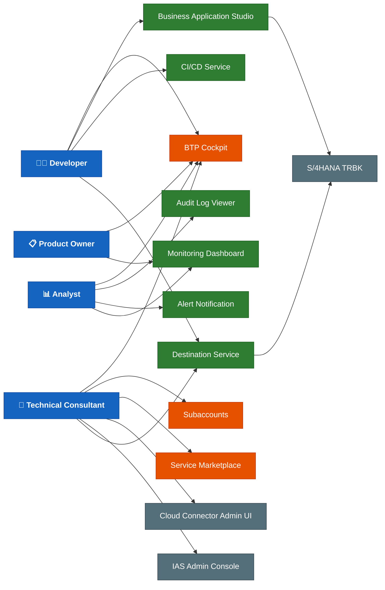
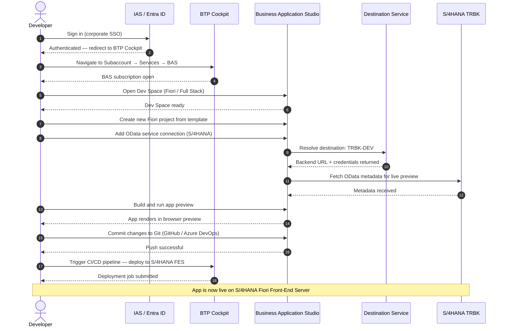
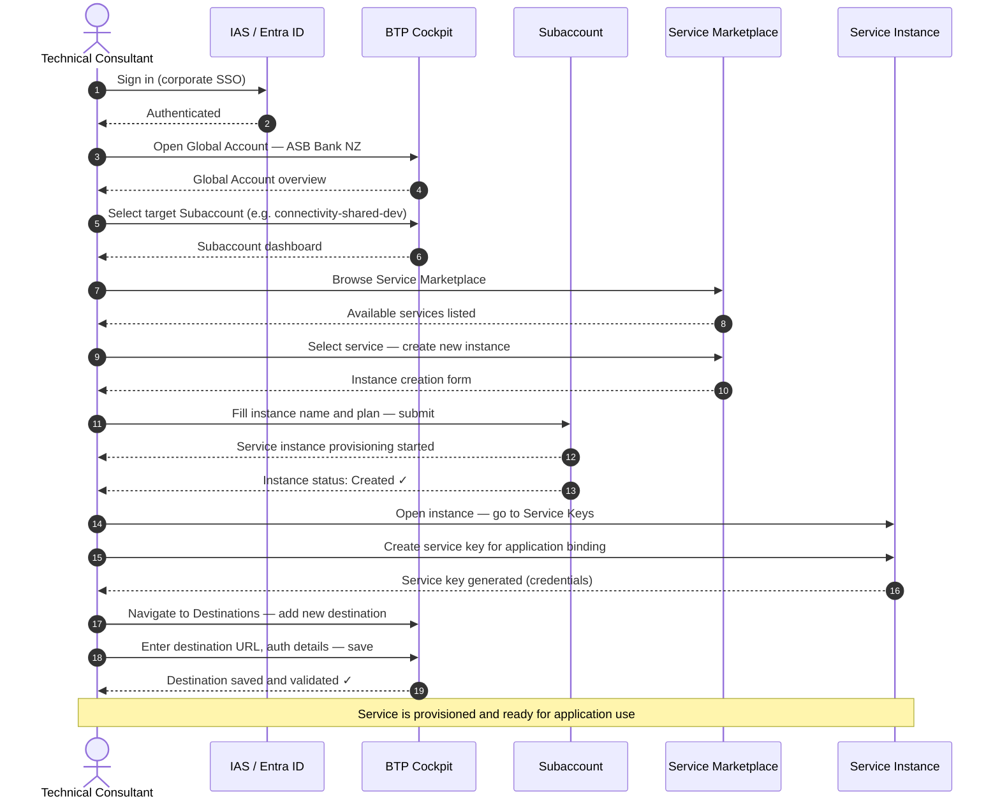
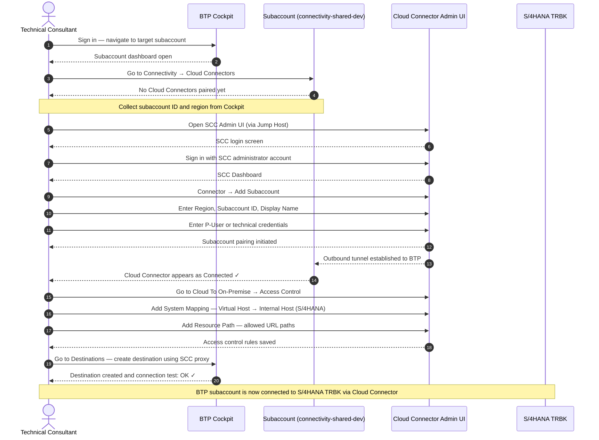
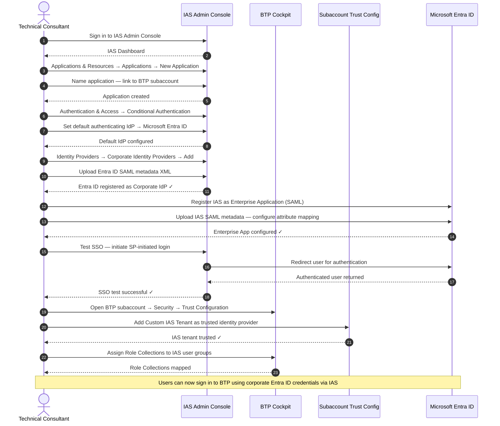
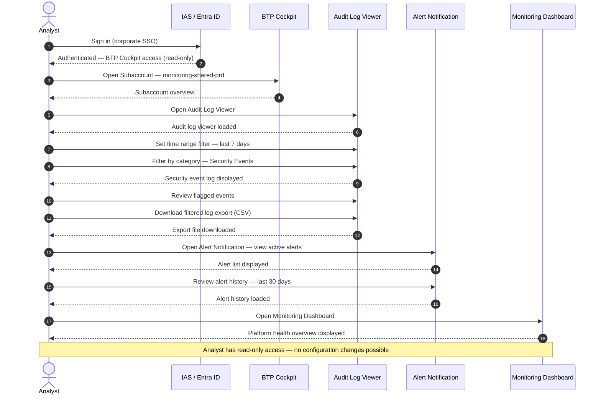
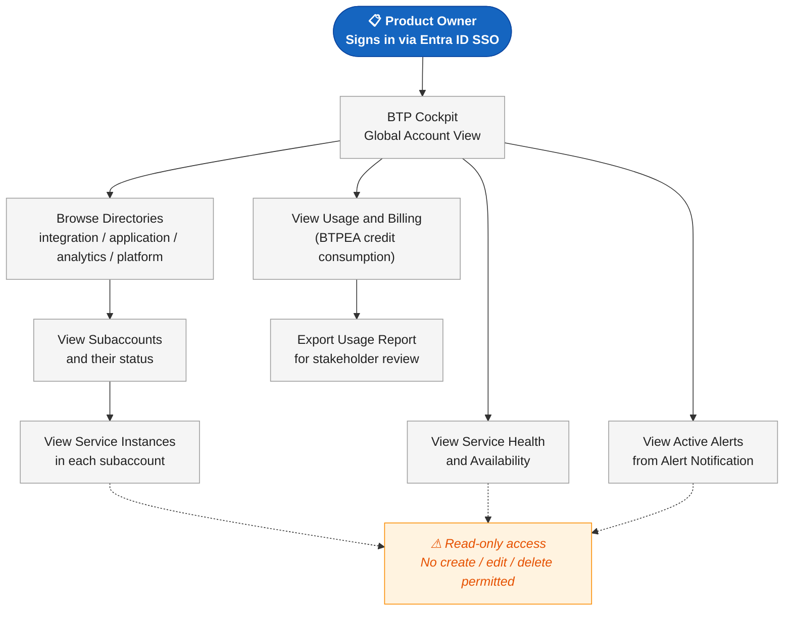
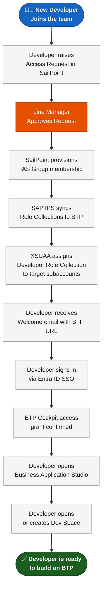

# SAP BTP Platform — Persona Access & Workflow Diagrams

> All diagrams are ADO Wiki compatible Mermaid. Paste each fenced block directly into an ADO Wiki page.
> Diagrams are intentionally kept simple — no protocol or security layer detail.

---

## Diagram Index

| # | Diagram | Type | Scenario |
|---|---|---|---|
| 1 | Persona to BTP Service Map | Flowchart (LR) | Who accesses what — overview |
| 2 | Developer — App Development Workflow | Sequence | Dev logs in, builds and deploys an app |
| 3 | Technical Consultant — Platform Service Configuration | Sequence | Configuring BTP services in a subaccount |
| 4 | Technical Consultant — Onboarding a Subaccount to SCC | Sequence | Connecting a BTP subaccount to Cloud Connector |
| 5 | Technical Consultant — IAS Authentication Setup | Sequence | Configuring IAS and Entra ID federation |
| 6 | Analyst — Monitoring and Audit Access | Sequence | Viewing audit logs and platform health |
| 7 | Product Owner — Read-Only Platform Visibility | Flowchart (TD) | Navigating BTP Cockpit for status and usage |
| 8 | New Developer Onboarding — From Access Request to First Dev Space | Flowchart (TD) | End-to-end access provisioning journey |

---

## Diagram 1 — Persona to BTP Service Map

> Who each persona interacts with on the BTP platform.



---

## Diagram 2 — Developer: App Development Workflow

> A developer logs in via SSO, opens a dev space in BAS, builds and previews a Fiori app against S/4HANA, and deploys it.



---

## Diagram 3 — Technical Consultant: Platform Service Configuration

> A consultant logs in, navigates to a subaccount, provisions a new BTP service, and configures it for use.



---

## Diagram 4 — Technical Consultant: Onboarding a Subaccount to Cloud Connector

> Connecting a BTP subaccount to an on-premise Cloud Connector instance so BTP services can reach S/4HANA TRBK.



---

## Diagram 5 — Technical Consultant: Setting Up IAS for Authentication

> Configuring SAP IAS as the identity broker, connecting Entra ID as the corporate identity provider, and enabling SSO for a BTP subaccount.



---

## Diagram 6 — Analyst: Monitoring and Audit Access

> An analyst logs in to review audit events, check platform health, and export logs for compliance review.



---

## Diagram 7 — Product Owner: Read-Only Platform Visibility

> How a Product Owner navigates BTP Cockpit to view platform status, service usage, and subaccount health.



---

## Diagram 8 — New Developer Onboarding: From Access Request to First Dev Space

> The end-to-end journey when a new developer joins and needs access to the BTP platform.



---

## Usage Notes for ADO Wiki

- Paste any ` ```mermaid ``` ` block directly into an ADO Wiki Markdown page
- Diagrams render automatically — no plugin required in Azure DevOps (Mermaid is natively supported in ADO Wiki)
- If a diagram appears blank, check for unsupported characters or missing `classDef` spacing
- Recommended page structure:
  - **Parent page**: Diagram 1 (Persona Map) — links to all child pages
  - **Child pages**: One per diagram (Diagrams 2–8)
- To widen diagrams in ADO Wiki, use `flowchart LR` instead of `flowchart TD`
