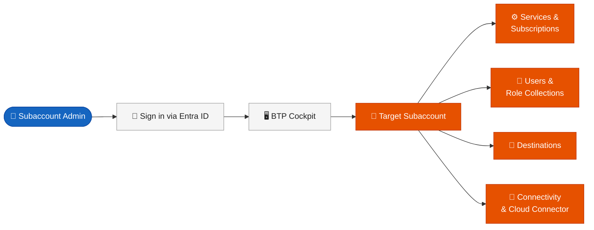
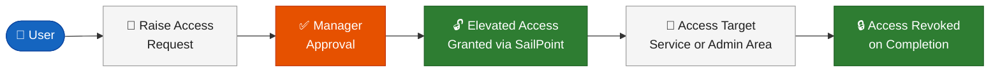
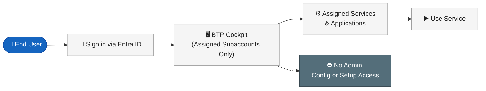
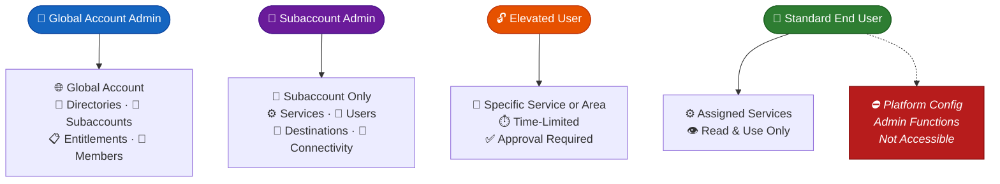

```mermaid

%%{init: {"theme": "base", "themeVariables": {"primaryColor": "#ffffff", "fontSize": "14px"}}}%%
flowchart TB

    subgraph GA["🔴  GLOBAL ACCOUNT ADMIN  ·  MOST ELEVATED"]
        direction TB
        GA_P["✅ PERMISSIONS & CONTROLS
        ▶ Global Account Lifecycle Management
        ▶ Sub-Account Create / Delete / Move
        ▶ Entitlement Allocation & Quota Mgmt
        ▶ Directory Structure Management
        ▶ IdP & Trust Configuration
        ▶ Billing & Commercial Views
        ▶ Global Role Collections
        ▶ Break-Glass Emergency Access"]

        GA_L["⛔ LIMITATIONS & BOUNDARIES
        ✗ Mandatory MFA + PAM tool approval
        ✗ Segregation of Duties (SoD) enforced
        ✗ All actions SIEM audit-logged
        ✗ Dual-approval for destructive operations
        ✗ No direct data-layer / DB access
        ✗ Privileged sessions time-boxed — JIT only"]

        subgraph SA["🟠  SUB-ACCOUNT ADMIN  ·  ELEVATED ACCESS"]
            direction TB
            SA_P["✅ PERMISSIONS & CONTROLS
            ▶ Sub-Account Configuration
            ▶ CF Org & Space Management
            ▶ Service Provisioning & Binding
            ▶ Role Collection Assignment (scoped)
            ▶ Destination & Connectivity Config
            ▶ Subscription Activation / Deactivation
            ▶ Security Policy & Certificate Mgmt"]

            SA_L["⛔ LIMITATIONS & BOUNDARIES
            ✗ Scoped to assigned sub-accounts only
            ✗ Cannot modify Global Account entitlements
            ✗ Cannot create or delete sub-accounts
            ✗ Cannot alter Global IdP / Trust Config
            ✗ Subject to SoD governance controls"]

            subgraph EU["🟡  ELEVATED USER  ·  RESTRICTED ELEVATED"]
                direction TB
                EU_P["✅ PERMISSIONS & CONTROLS
                ▶ Service Instance Management
                ▶ CF Application Deployment (cf push)
                ▶ CF Space Developer Rights
                ▶ Monitoring & Centralized Log Access
                ▶ Service Key / Binding Generation
                ▶ Limited Role Assignment (own space only)"]

                EU_L["⛔ LIMITATIONS & BOUNDARIES
                ✗ No CF Org-level admin rights
                ✗ No billing or cost center visibility
                ✗ Restricted to assigned CF Spaces only
                ✗ Cannot bind external destinations
                ✗ No subscription management rights"]

                subgraph SU["🟢  SERVICE / SUBSCRIPTION USER  ·  LEAST PRIVILEGE"]
                    direction TB
                    SU_P["✅ PERMISSIONS & CONTROLS
                    ▶ Service Consumption Only
                    ▶ Read-Only Platform Views
                    ▶ Assigned-Service Scope Only
                    ▶ App End-User Access
                    ▶ API Consumer — scoped OAuth token"]

                    SU_L["⛔ LIMITATIONS & BOUNDARIES
                    ✗ Cannot provision or configure services
                    ✗ No administrative capabilities
                    ✗ No role assignment rights
                    ✗ Restricted to assigned subscriptions
                    ✗ Read-only audit and log views"]

                    CORE(["⚙️  BTP CORE PLATFORM
                    Protected Foundation Services
                    — All tiers wrap this layer —"])
                end
            end
        end
    end

    style GA  fill:#fadbd8,stroke:#a93226,stroke-width:4px,color:#7b241c
    style SA  fill:#fce8d5,stroke:#b34a00,stroke-width:3px,color:#7a3000
    style EU  fill:#fef9e7,stroke:#b8860b,stroke-width:3px,color:#7a5c00
    style SU  fill:#d5f5e3,stroke:#1a7a44,stroke-width:3px,color:#0e5c30
    style CORE fill:#d6eaf8,stroke:#2471a3,stroke-width:3px,color:#154360,font-weight:bold

    classDef gaNode  fill:#f9ebea,stroke:#a93226,stroke-width:1.5px,color:#7b241c,text-align:left
    classDef saNode  fill:#fef5e7,stroke:#b34a00,stroke-width:1.5px,color:#7a3000,text-align:left
    classDef euNode  fill:#fffef0,stroke:#b8860b,stroke-width:1.5px,color:#7a5c00,text-align:left
    classDef suNode  fill:#e9f7ef,stroke:#1a7a44,stroke-width:1.5px,color:#0e5c30,text-align:left

    class GA_P,GA_L gaNode
    class SA_P,SA_L saNode
    class EU_P,EU_L euNode
    class SU_P,SU_L suNode
```

# SAP BTP — Simple Traffic Flow Diagrams

> Minimal access flow diagrams for ADO Wiki. Each diagram is intentionally short — 5 to 7 nodes maximum.
> Icons use Unicode emoji (universally supported in ADO Wiki Mermaid). See icon legend at the bottom of this page.

---

## Diagram 1 — Global Account Administrator Access Flow

---

## Diagram 2 — Subaccount Administrator Access Flow

---

## Diagram 3 — Elevated User Access Flow

---

## Diagram 4 — Standard End User Access Flow

---

## Diagram 5 — Creating a Destination

---

## Diagram 6 — Access Level Comparison (All Personas)

> At-a-glance view of what each access level can reach.

---

## Icon Legend

| Icon | Represents in Diagrams |
|---|---|
| 👑 | Global Account Administrator |
| 🔧 | Subaccount Administrator |
| 👤 | Standard User / End User |
| 🔓 | Elevated / Temporary Access Granted |
| 🔒 | Access Revoked |
| 🔑 | Authentication — Entra ID / IAS Sign-in |
| 🖥️ | BTP Cockpit |
| 🌐 | Global Account |
| 📂 | BTP Directory |
| 📁 | BTP Subaccount |
| ⚙️ | Services & Subscriptions |
| 👥 | Users, Members & Role Collections |
| 🔗 | Destination Service |
| 🔌 | Connectivity & Cloud Connector |
| 📋 | Entitlements & Licensing |
| 📝 | Form / Data Entry Step |
| ➕ | Create New |
| 🧪 | Test / Validate Connection |
| ✅ | Approved / Success |
| ⛔ | Not Accessible / Blocked |
| 🎯 | Targeted / Scoped Access |
| ⏱️ | Time-Limited Access |
| 👁️ | Read-Only |
| ▶️ | Use / Run Service |

---

