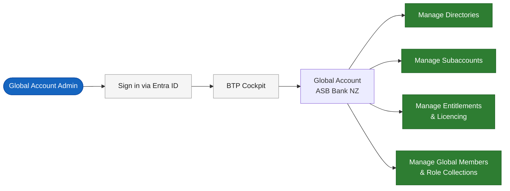
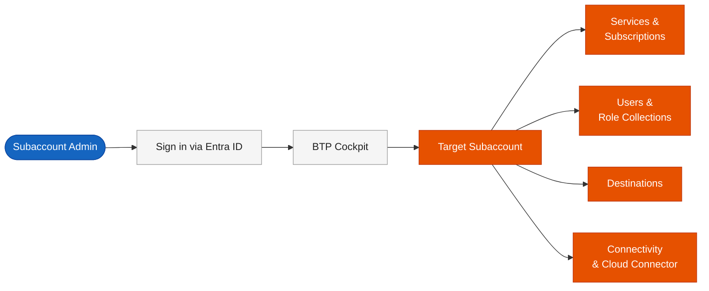
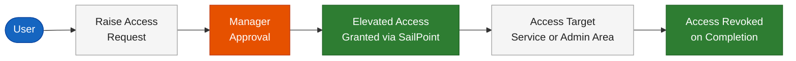
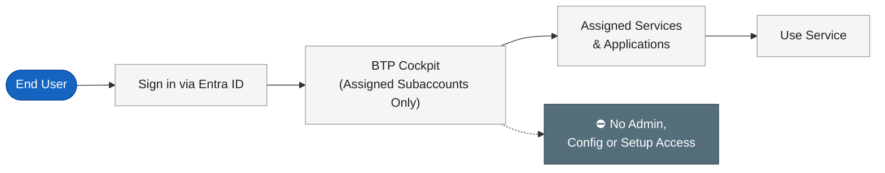
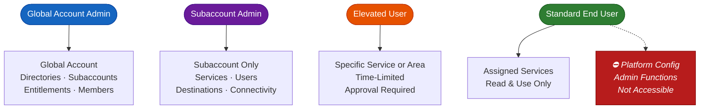

# SAP BTP — Simple Traffic Flow Diagrams

> Minimal access flow diagrams for ADO Wiki. Each diagram is intentionally short — 5 to 7 nodes maximum.

---

## Diagram 1 — Global Account Administrator Access Flow

---

## Diagram 2 — Subaccount Administrator Access Flow

---

## Diagram 3 — Elevated User Access Flow

---

## Diagram 4 — Standard End User Access Flow

---

## Diagram 5 — Creating a Destination

---

## Diagram 6 — Access Level Comparison (All Personas)

> At-a-glance view of what each access level can reach.

---
